# Appendix G — Canonical Diagrams

These Mermaid diagrams apply approved canonical concepts to the Government Depository Program. They describe responsibility and sequence, not production topology, public authority, procurement status, or legal fund characterization.

## Program Participants

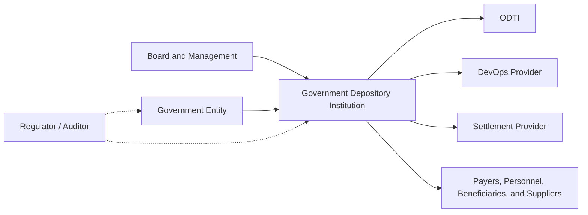

## Institutional Boundaries

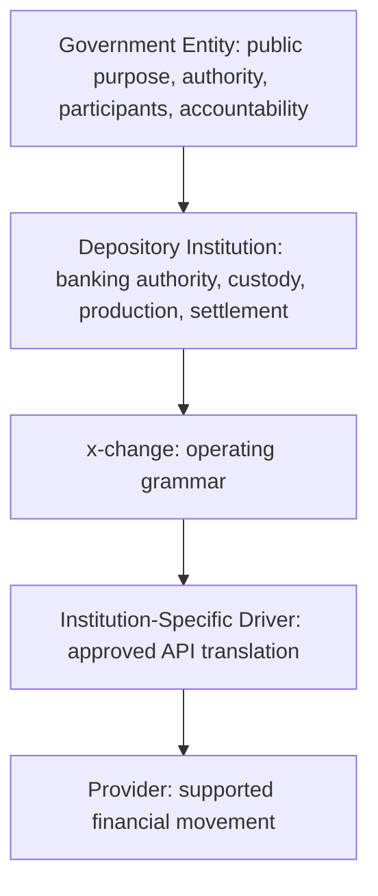

## Banking Operating Model

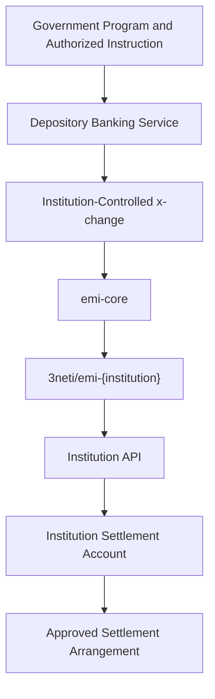

## Operating Grammar

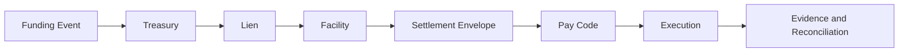

## Funding Event

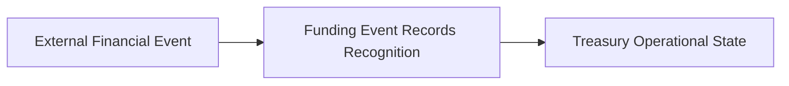

## Treasury

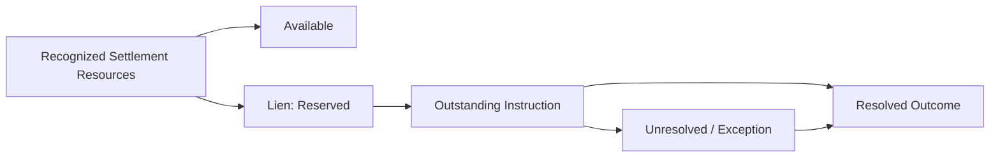

## Deposit Flow

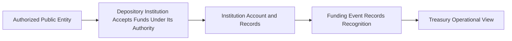

## Driver Architecture

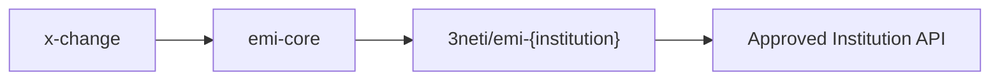

## Program Lifecycle

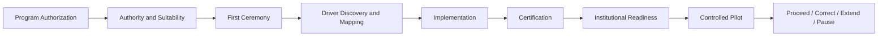

## Readiness

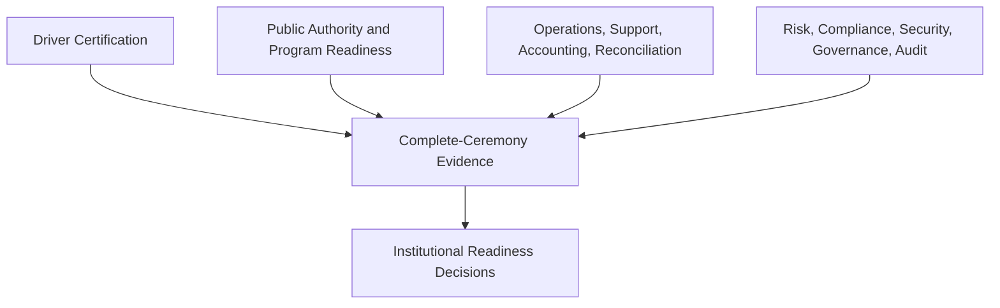

## LGU Assistance Flow

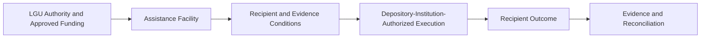

## Payroll Flow

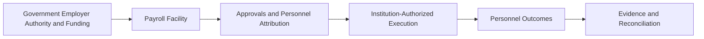

## Pension and Benefit Flow

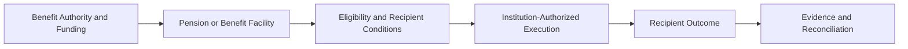

## Merchant Flow

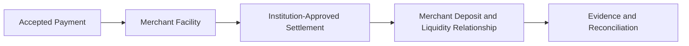

## Government Collection Flow

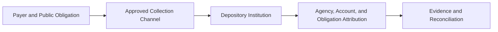

## Government Disbursement Flow

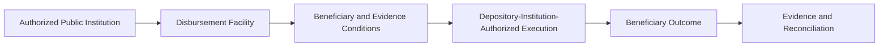

## Commercial Waterfall

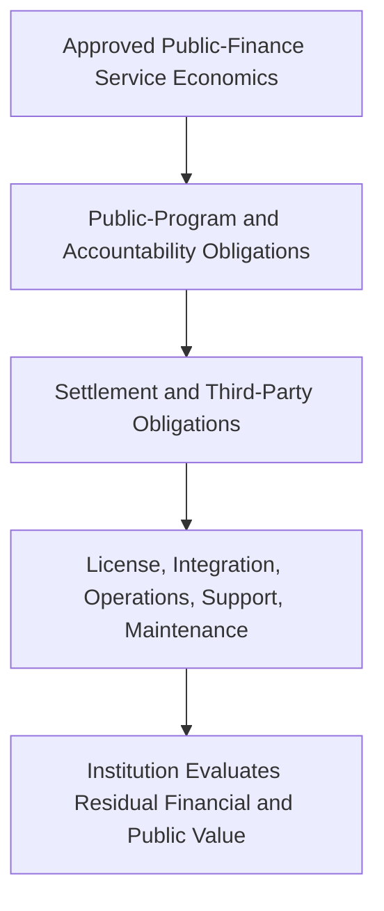

## Public-Finance Relationship Expansion

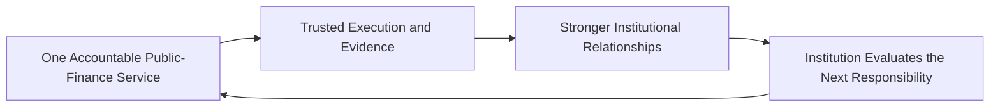

## Deployment Architecture

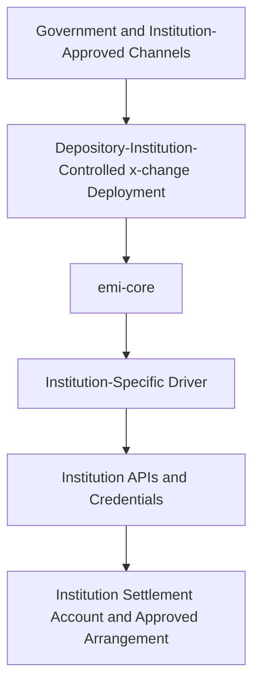
