# RBAP Digital Banking Program

## Program Guide

### A Collective Modernization Initiative for Philippine Rural Banks

## Executive Summary

Philippine rural banks remain indispensable to the communities they serve. They finance farmers, families, entrepreneurs, and local enterprises through relationships built over decades. The question is how these institutions can establish modern digital banking capability without each bank independently carrying the full cost and complexity of building, securing, integrating, and continually renewing the same foundations.

The economics of digital banking have changed. Enterprise cloud operations, modern software delivery, managed infrastructure, API-based banking services, and national payment rails have made capabilities available that once required substantial institution-specific investment. A rural bank no longer needs to create every technical foundation alone. What remains necessary is a coordinated institutional model through which common capability can be shared without weakening the authority, identity, or independence of the participating bank.

The proposed RBAP Digital Banking Program provides that model. It is a voluntary modernization program administered by the Rural Bankers Association of the Philippines for participating member banks. RBAP serves as sponsor, convenor, ecosystem steward, and program administrator. Open Disbursement Technologies, Inc. licenses and maintains the x-change platform. Certified DevOps providers deploy and operate each bank's approved environment under delegated authority. Regulated settlement institutions provide the accounts, banking APIs, payment rails, and settlement services through which authorized instructions are executed.

The Program does not make RBAP a bank, settlement institution, or payment switch. It does not create a pooled customer-funds arrangement or shared production platform.

Each rural bank operates its own licensed deployment. It owns or controls its infrastructure, domains, databases, service-provider accounts, credentials, security configuration, institutional data, release approvals, and production environment. It retains its banking license, governance, customer and deposit relationships, operating policies, and direct settlement relationship. Funds remain within regulated banking relationships, and the settlement institution performs the supported financial movement. x-change coordinates authorized banking activity; it does not replace the bank or become custodian of customer funds.

Common software does not create a common bank. What becomes shared is the work no institution benefits from repeating alone: maintained software, supported integrations, implementation knowledge, operating standards, and the engineering discipline required to keep a modern foundation current. Each participating bank decides which services to offer, which policies to apply, which customer journeys to approve, and when a capability is ready for production.

For an individual rural bank, the resulting value is institutional rather than merely technical. The Program provides a reusable foundation through which the bank can introduce modern services without treating each new service as another independent technology project. Remittance, payroll, merchant payments, collections, government disbursements, and future banking services can be organized as distinct banking ceremonies while drawing on the same governed operating model.

As the bank becomes useful across more recurring financial needs, individual transactions can develop into broader banking relationships. A remittance customer may later receive payroll through the same institution. An employer relationship may lead to collections, merchant services, or employee banking. This accumulation of recurring relationships is the basis of Transaction Gravity. Its significance lies not in transaction volume alone, but in the bank's continuing relevance to customers, enterprises, public institutions, and its community.

Remittance provides the clearest illustration of how the Program works. A customer asks the bank to send funds to a recipient under defined conditions. The bank receives the funds, confirms its authority, applies its policies, prepares the service, coordinates settlement, preserves the required evidence, and reconciles the result. The customer experiences a familiar remittance. The bank operates a governed banking ceremony. The Pay Code serves as the credential through which the authorized instruction can be presented and completed.

**The customer requested a banking outcome. The bank arranged it.**

Once that ceremony is understood, other services become recognizable variations of the same banking discipline. The participants, purpose, conditions, and customer journey may change without requiring the institution to rebuild the operating foundation beneath them.

The Board is therefore considering more than a software acquisition. It is considering whether the rural banking sector should establish a continuing institutional capability through which member banks can deepen relationships, adapt to new responsibilities, and extend useful services while preserving their independence. Resilience allows a bank to continue what it already does. Adaptability allows it to assume new responsibilities without rebuilding its foundation each time.

Commercial sustainability remains necessary. Each bank must compare the cost of participation with the cost of building, integrating, operating, securing, and renewing similar capability alone. Potential value may appear through service income, deeper deposit and customer relationships, stronger employer and merchant relationships, reduced duplicated engineering, and the ability to introduce services through an established foundation. None is an automatic return. The commercial model must allocate costs, income, and obligations transparently enough to support continuing service, maintenance, and participation.

If the RBAP Board approves the Program, approval begins an institutional process; it does not place a participating bank into production. RBAP Management establishes program governance, completes the common licensing and participation arrangements, and begins work with the first participating institution. That bank separately approves its own participation, explains how it operates, defines its first banking ceremony, establishes its operating and settlement foundations, confirms operational readiness, prepares its personnel, and begins a controlled production pilot.

Pilot success is judged against evidence agreed in advance. The bank must be able to authorize the service correctly, settle and reconcile it dependably, support customers, resolve exceptions, and maintain the operating discipline required for continued use. The evidence supports an institutional decision: proceed, correct, extend, or pause. Expansion follows only when the bank and Program governance are satisfied that the next step is warranted.

The decision before RBAP is whether to establish this coordinated modernization framework and authorize Management to complete the arrangements required for a controlled beginning. Approval would not compel every member bank to participate, prescribe identical services, or transfer banking authority to the Association. It would create the institutional basis through which participating rural banks may modernize together while remaining independent institutions.

**Participating banks compete independently while modernizing collectively.**

## Section 1 — Why This Program?

> **Executive question:** Why should RBAP launch the Digital Banking Program now?

> **Key message:** For the first time, the technological, operational, and settlement foundations required for collective digital modernization have converged. What was once prohibitively expensive and operationally impractical is now achievable. RBAP is uniquely positioned to transform these developments into a coordinated modernization program for Philippine rural banks.

> **Executive decision:** RBAP should evaluate the establishment of the Digital Banking Program because the conditions that make collective modernization practical now exist.

### The Opportunity

For generations, rural banks have been among the Philippines' most trusted financial institutions. They have financed farmers, entrepreneurs, families, and local enterprises while serving communities that larger financial institutions have often found difficult to reach. Their strength has never depended solely on size. It has depended on proximity, relationships, and trust.

That trust remains one of the rural banking sector's greatest strengths.

What has changed is not the mission of rural banking.

What has changed is the technology available to support that mission.

For decades, the economics of digital banking favored only the largest institutions. Banks wishing to modernize were expected to invest in their own data centers, proprietary banking software, dedicated infrastructure, leased communication lines, specialized operations teams, and continuous technology refresh cycles. Digital transformation was not merely a software project—it was a significant institutional undertaking that only a limited number of organizations could realistically sustain.

That environment has changed fundamentally.

Cloud infrastructure has matured into an enterprise-grade operating model. Modern software engineering practices such as continuous integration, automated testing, continuous deployment, infrastructure automation, and managed cloud services have significantly reduced the complexity of delivering and operating sophisticated banking software. Institutions no longer need to build every technological capability independently in order to benefit from it.

The banking ecosystem has also evolved.

National payment infrastructure such as BancNet, InstaPay, and PESONet has established a modern settlement foundation for the movement of funds throughout the country. API-based banking platforms now allow regulated financial institutions to connect to these settlement rails through standardized integrations rather than proprietary interfaces developed independently by every institution.

Taken together, these developments have fundamentally changed the economics of digital banking.

### Why Rural Banks Need Collective Modernization

For the first time, a rural bank with limited internal technology resources can realistically operate modern digital banking capabilities without maintaining a large in-house software engineering organization. Cloud-native operations, managed infrastructure, modern DevOps practices, and API-based settlement services have lowered the barriers to participation while allowing every institution to retain control over its own operations and customer relationships.

**Technology alone does not create a modernization program.**

A coordinated operating model is still required.

Common software must preserve institutional independence. Settlement must remain within regulated financial infrastructure. Every participating bank must continue to own its customer relationships, data, governance, operating policies, and banking relationships. Common capabilities must reduce repeated engineering without creating a common bank, a centralized production environment, or a shared operational authority.

Only recently have these technological advances become capable of supporting a coordinated modernization program specifically designed for Philippine rural banking.

### Why RBAP?

This convergence creates an opportunity uniquely suited to the Rural Bankers Association of the Philippines.

For decades, RBAP has strengthened the rural banking sector by bringing independent institutions together through advocacy, education, professional development, policy engagement, and collaboration. Digital modernization represents the next opportunity through which the Association can create value for its membership—not by becoming a bank, not by operating a payment network, and not by centralizing banking operations—but by coordinating a voluntary modernization program that every participating member bank may adopt according to its own priorities.

### Why Now?

This distinction is fundamental.

The proposed Program does not ask rural banks to surrender their independence.

It asks them to modernize together.

Each participating institution retains its banking license, customer and deposit relationships, governance, cloud environment, operational policies, and settlement relationships. What becomes common is not the bank itself, but the software, operating standards, implementation knowledge, and reusable digital capabilities that no institution should have to build repeatedly on its own.

This is where x-change enters the picture.

Rather than positioning itself as another financial institution, payment network, or digital wallet, x-change provides the common operating framework that enables participating banks to coordinate modern banking workflows while preserving institutional sovereignty. It complements existing regulated financial infrastructure rather than replacing it.

The RBAP Digital Banking Program is therefore not a software deployment.

It is a collective modernization initiative.

It transforms recent advances in cloud computing, modern software delivery, and programmable banking infrastructure into a practical program that participating rural banks can confidently adopt while remaining fully independent institutions.

The question is no longer whether Philippine rural banks can modernize collectively.

The technology now exists.

The settlement infrastructure now exists.

The operating model now exists.

**The opportunity now exists for the rural banking sector to act collectively.**

The RBAP Digital Banking Program is proposed as the mechanism through which that opportunity can be realized.

### Section Summary

The technological conditions that once limited digital banking to the largest financial institutions have fundamentally changed. Modern cloud operations, API-based settlement infrastructure, and a Philippine-designed banking operating model now make collective modernization both practical and economically achievable. The RBAP Digital Banking Program proposes to transform these developments into a coordinated initiative through which participating rural banks can modernize together while preserving their operational sovereignty, institutional identity, and customer relationships.

## Section 2 — What Is the Program?

> **Executive question:** What exactly is RBAP being invited to launch?

> **Key message:** RBAP is launching a coordinated banking modernization program—not operating a bank, payment switch, settlement network, or common production platform.

> **Executive decision:** RBAP can determine whether the proposed Program provides an appropriate institutional structure through which its member banks may acquire, deploy, and operate modern digital banking capabilities while preserving their independent authority and operations.

### Program Overview

The RBAP Digital Banking Program establishes a coordinated framework through which participating rural banks may deploy, operate, and maintain modern digital banking capabilities.

The Program combines licensed software, regulated settlement connectivity, institution-specific deployment, managed DevOps services, platform maintenance, and common operating standards within an institutional program administered by the Rural Bankers Association of the Philippines.

The Program is intended to provide participating banks with the capability to automate authorized front-office and back-office banking instructions, including person-to-person fund transfer workflows, through software-based execution and regulated settlement infrastructure.

Participation does not create a common bank or a centralized production environment. Each participating institution remains responsible for its banking authority, governance, customer and deposit relationships, operating policies, infrastructure, security controls, and settlement arrangements.

The Program provides common technology and coordinated support. Each participating rural bank operates independently.

### Program Participants

The Program consists of organizations with distinct and non-overlapping responsibilities.

The principal participants are:

- the Rural Bankers Association of the Philippines;
- Open Disbursement Technologies, Inc.;
- participating rural banks;
- regulated settlement institutions;
- certified DevOps providers; and
- approved value-added service providers.

RBAP administers the collective Program.

ODTI licenses and maintains the technology.

Each rural bank operates its own licensed deployment.

The settlement institution provides regulated accounts, payment rails, and banking APIs.

The certified DevOps provider performs implementation and continuing technical operations under delegated authority.

Value-added providers may supply services such as cloud infrastructure, database services, messaging, identity verification, location services, notifications, security services, and other required capabilities.

Participation in the same Program does not merge the legal identity, operations, data, funds, credentials, or regulatory responsibilities of the participating institutions.

### Roles and Responsibilities

#### Rural Bankers Association of the Philippines

RBAP serves as the Program sponsor, convenor, ecosystem steward, and program administrator.

Its proposed responsibilities include:

- establishing the Program for participating member banks;
- administering participation and license-seat allocation;
- coordinating institutional engagement;
- establishing common program standards;
- facilitating relationships among participating banks, ODTI, settlement institutions, DevOps providers, and other service providers;
- supporting sector-level governance and program review; and
- participating in the Program's commercial structure where approved.

RBAP does not operate the participating banks, maintain customer deposits, execute settlement, control bank production systems, or act as a payment switch.

#### Open Disbursement Technologies, Inc.

ODTI serves as the technology licensor, software maintainer, platform steward, and program technology authority.

ODTI provides the x-change software platform, its supporting components, and the default host application presently represented by x-Payout.

Its responsibilities include:

- maintaining the licensed software;
- publishing maintained releases;
- maintaining supported integration components;
- providing technical documentation and reference configurations;
- supporting compatibility and platform evolution;
- defining certification requirements for approved implementation and DevOps providers;
- supporting implementation governance; and
- monitoring authorized platform and transaction operating indicators required to maintain software quality, interoperability, and program health.

ODTI does not become the participating bank, settlement institution, infrastructure owner, or custodian of customer funds.

#### Participating Rural Bank

Each participating rural bank deploys and operates a licensed digital banking environment under its own authority.

The participating bank owns or controls its:

- cloud account or approved hosting environment;
- domains;
- application deployment;
- databases;
- customer and institutional data;
- security configuration;
- service-provider accounts;
- credentials and keys;
- release approvals;
- operational policies;
- monitoring and backup arrangements;
- settlement account; and
- settlement API credentials.

The bank remains responsible for its customer and deposit relationships, banking decisions, compliance obligations, operating authority, and approval of production changes.

#### Settlement Institution

The settlement institution provides the regulated financial infrastructure through which authorized banking instructions are executed.

Under the initial proposed arrangement, NetBank serves as the first settlement institution integrated with the platform.

Each participating rural bank establishes its own banking relationship with NetBank, opens its own settlement account, and receives its own API credentials for supported services and payment rails, including InstaPay and PESONet where available under the applicable arrangement.

The relationship between the rural bank and NetBank is a direct banking relationship. RBAP and ODTI do not become the settlement provider.

#### Certified DevOps Provider

A certified DevOps provider onboards the participating bank into the bank's approved technical operating environment and provides continuing infrastructure and deployment support.

Its responsibilities may include:

- provisioning the approved cloud environment;
- deploying the licensed application;
- configuring infrastructure and supported services;
- integrating authorized provider credentials;
- establishing development, staging, and production workflows;
- implementing continuous integration and deployment controls;
- conducting deployment and operational tests;
- maintaining deployment health;
- applying approved software releases;
- supporting backups, recovery, monitoring, and incident response; and
- providing continuing technical maintenance.

The DevOps provider operates only within the authority delegated by the bank.

The bank remains the owner or account holder for its infrastructure, billing relationships, service subscriptions, domains, databases, credentials, and institutional data.

#### Value-Added Service Providers

A participating bank may require additional services to operate its deployment.

These may include:

- cloud computing;
- virtual machines or managed application hosting;
- storage;
- databases;
- broadcasting and asynchronous processing;
- SMS and other messaging;
- identity and KYC services;
- location services;
- document and evidence storage;
- monitoring;
- cybersecurity services; and
- other approved infrastructure or banking-support services.

The participating bank establishes and funds its own provider accounts unless a different approved procurement arrangement applies.

### Governance Model

The Program preserves institutional sovereignty while establishing common software, implementation, and operating standards.

RBAP governs participation at the program level.

ODTI governs the licensed software, supported integrations, release standards, compatibility requirements, and technology-certification framework.

Each participating rural bank governs its own production environment, banking operations, customer relationships, security policies, provider accounts, release approvals, and settlement authority.

Certified DevOps providers operate within approved technical standards and institution-specific delegations.

Settlement institutions remain responsible for the regulated accounts, banking APIs, payment rails, and services they provide.

The governance model separates program coordination, software authority, bank authority, infrastructure operations, and settlement responsibility. No participant acquires another participant's institutional authority solely through participation in the Program.

### Licensing Model

ODTI provides the Program technology to RBAP under a proposed group-licensing arrangement.

The group license establishes the number of participating-bank seats available under the Program. RBAP allocates a seat to each approved participating member bank and may increase the licensed seat capacity as participation expands.

Each allocated seat authorizes one participating institution to deploy and operate an approved instance of the licensed platform, subject to the applicable participation instrument, software license terms, operating requirements, and program standards.

The bank-level participation instrument should be appropriate to an institutional software program. It may take the form of a participation agreement, sublicense acceptance, accession agreement, institutional software-license acknowledgment, or another approved instrument. The final legal form remains subject to commercial and legal review.

The licensed technology presently includes:

- the x-change platform;
- supporting x-change components;
- the x-Payout host application;
- maintained software releases;
- technical documentation;
- supported integration components;
- reference deployment materials; and
- continuing platform maintenance within the agreed license scope.

Source code access may be provided within the approved licensing and repository-access model. Source code availability does not replace implementation, deployment, integration, operational support, or institution-specific configuration.

The license grants access to the technology.

It does not represent a turnkey deployment without the corresponding implementation and operating services.

### Commercial Model — overview only

The Program separates software licensing from professional and managed services.

The principal commercial components may include:

- the ODTI group license administered through RBAP;
- participating-bank license seats;
- bank onboarding and initial deployment;
- continuing DevOps and maintenance services;
- cloud and third-party service-provider costs;
- supported integration and customization services;
- platform support;
- program administration; and
- transaction-linked commercial participation through the approved Commercial Waterfall.

RBAP may charge participating member banks for Program participation, seat allocation, program administration, common services, or other approved benefits.

Each participating rural bank remains responsible for its institution-specific infrastructure, service-provider subscriptions, settlement banking relationship, deployment, and continuing operations unless the approved commercial arrangement provides otherwise.

RBAP may maintain an account with the settlement institution for the receipt of its approved Commercial Waterfall participation or other Program revenues. Such an account would receive amounts attributable to RBAP and would not serve as the pooled settlement account of participating rural banks.

Detailed pricing, cost allocation, revenue participation, and Commercial Waterfall rules are reserved for Section 6, Appendix C, and institution-specific commercial proposals.

The Program Guide defines the commercial structure.

The proposal to RBAP will define the financial consideration, negotiated terms, implementation commitments, and requested approvals.

### Section Summary

The RBAP Digital Banking Program is a coordinated institutional framework through which participating rural banks may acquire and operate modern digital banking capabilities.

RBAP administers the Program.

ODTI licenses and maintains the technology.

Each participating rural bank owns or controls its licensed deployment, infrastructure, and service-provider accounts, and retains its customer and deposit relationships and direct settlement relationship.

The settlement institution provides regulated accounts, banking APIs, and payment rails.

Certified DevOps providers deploy and maintain each institution's environment under delegated authority.

The Program establishes common technology and coordinated standards without creating a common bank, shared production platform, payment switch, or pooled customer funds arrangement.

## Section 3 — Why Should a Rural Bank Participate?

> **Executive question:** What does an individual rural bank gain?

> **Key message:** Every participating bank modernizes while preserving its identity, customers, governance, and independence.

> **Executive decision:** I understand how my institution would benefit from participating in the Program and can determine whether those benefits support further institutional evaluation.

### Modern Digital Banking

Participation enables a rural bank to establish a modern digital banking capability without designing every technical foundation independently.

The platform uses a modular architecture designed for cloud operations and API-based integration. Automated testing, controlled software delivery, infrastructure automation, and continuing operational support are part of the foundation, not additions applied after deployment.

Continuous integration and continuous deployment controls make testing and release processes repeatable. Deployment automation makes approved environments reproducible. Infrastructure automation reduces dependence on undocumented manual configuration.

APIs provide governed integration points for settlement institutions and other approved service providers. Monitoring, backup, recovery, and security controls form part of the operating discipline surrounding the platform.

These capabilities do not diminish the participating bank's authority over technology decisions. The bank approves its production environment, credentials, integrations, operating policies, and software releases. Modern engineering practices allow that authority to be exercised with greater consistency.

The result is not a generic banking application presented as a complete digital bank. It is a current, extensible digital operating environment on which the institution can develop banking capabilities according to its requirements and under its authority.

### Independent Operations

Operational sovereignty remains with each rural bank.

The participating institution owns or controls its cloud account, infrastructure, application deployment, databases, institutional data, domains, service-provider accounts, credentials, monitoring, backups, and release approvals.

The bank establishes its own settlement relationship and operates under its own banking authority, governance, compliance obligations, and security policies.

Infrastructure is only one expression of this independence.

Each institution determines the customer experience through which its services are presented. It controls its operating workflows, commercial participation, branding, domains, notification channels, and SMS sender identity. Customer communications, KYC progression, banking ceremonies, default riders, institution-specific API endpoints, and approved service integrations likewise remain under its direction.

Common software does not require common presentation, common customer policies, or a common operating identity. Two participating banks may share the same engineering foundation while presenting different services, experiences, and institutional identities. Each may evolve according to its own strategy and the needs of its community.

The Program therefore enables each participating institution to establish its own digital banking platform. That platform reflects the institution's strategy and can develop with it over time.

It does not prescribe a complete online banking stack, replace the core banking system, or require the institution to adopt another organization's model of digital banking.

The Program supplies a maintained engineering foundation and coordinated operating support. The institution determines how that foundation is expressed through its services, policies, relationships, and identity.

The result is a digital presence recognizably the bank's own, built on a common foundation it does not have to create alone.

### Common Licensed Software

Modernization no longer needs to begin as a software construction project.

Participating banks begin with common licensed software already engineered for operational use. The Program provides a maintained platform, supporting components, reference architecture, deployment materials, integration components, and an approved framework for implementation and continuing operations.

This common foundation covers work that every institution would otherwise repeat. It establishes environment structure, deployment patterns, software release practices, integration approaches, operational controls, technical documentation, and baseline monitoring and recovery arrangements.

Reuse reduces duplicated engineering while preserving institution-specific deployment and authority.

The reference architecture provides an established starting point. Deployment automation applies that architecture consistently within the bank's approved environment. Certified DevOps providers bring defined implementation and operating practices.

Maintained releases allow the platform to evolve without requiring each participating bank to establish a separate software product organization.

Implementation still requires institutional preparation. The bank must establish its infrastructure, provider relationships, settlement connectivity, credentials, approvals, and operating responsibilities. The Program does not remove those obligations, nor does it make deployment turnkey or eliminate the need for implementation services.

It does, however, change the starting condition. The institution begins with an engineered and supportable foundation rather than an unformed technology project. Modernization becomes a governed implementation of established capability, supported by common standards for continuing operation and controlled evolution.

### Shared Standards

Common software becomes institutionally useful only when it is supported by common standards.

The Program sets shared expectations for engineering, integration, deployment, releases, documentation, testing, security, and operations. These standards enable participating banks, ODTI, certified DevOps providers, settlement institutions, and approved service providers to work within a consistent frame of reference while retaining their separate responsibilities.

Shared standards support interoperability by defining compatibility expectations for integration components and software releases.

They support consistent quality through repeatable testing, controlled deployment, observable operations, documented recovery practices, and approved change processes. They also make provider certification meaningful by establishing the operating disciplines against which implementation capability can be assessed.

The standards do not create shared production authority. Each bank continues to approve its own releases, manage its credentials, govern its environment, and determine which supported capabilities it will adopt. A common standard defines how an approved capability should be implemented; it does not decide whether or when a bank must use it.

This distinction allows common standards to increase institutional independence. Banks gain access to continuing software evolution and a broader implementation ecosystem without becoming dependent on undocumented, institution-specific engineering. Predictable operating practices make future change more manageable while leaving institutional decisions with the bank.

That distinction becomes critical when the platform connects to regulated settlement infrastructure.

### Settlement Connectivity

Digital banking capability must remain connected to regulated financial infrastructure.

Each participating rural bank establishes and maintains its own relationship with its settlement institution. The bank holds its own settlement account, controls its own provider credentials, and retains authority over the banking instructions executed through that relationship.

Participation in the Program does not pool settlement accounts or transfer settlement authority to RBAP, ODTI, or a DevOps provider.

Customer funds remain in the participating bank's custody and under its banking responsibility. Customer and deposit relationships remain with the bank.

x-change does not receive deposits, hold customer funds, issue a wallet balance, or become the settlement institution. It provides digital operating capability through which authorized instructions can be coordinated under the bank's policies and authority.

This structure enables a participating institution to use modern settlement connectivity without surrendering custody, institutional accountability, or control of its regulated relationships.

Section 4 explains the operating model through which Funding Events, Treasury, Facilities, Settlement Envelopes, Pay Codes, and Execution are coordinated. At this stage, the essential point is narrower: the technology enables activity, while the bank retains the funds, relationships, credentials, and authority.

With those boundaries clear, the bank can decide which new services to introduce.

### New Banking Services

The value of a digital banking platform lies in the services an institution chooses to operate through it.

Participating banks may introduce capabilities such as payroll, merchant payments, collections, remittances, government services, customer engagement, and other modular banking services supported by the Program.

Adoption may follow institutional priorities rather than a single prescribed sequence. A bank may begin with one bounded service and add capabilities as governance, operating readiness, and customer demand develop.

These services create value beyond the execution of individual transactions.

A payroll relationship may create opportunities for recurring deposits, employee services, and broader financial relationships. Merchant payments may support merchant acquisition, collections, liquidity visibility, and continuing business engagement. Remittance services may create opportunities to serve both recipients and the families or enterprises connected to them. Government services may strengthen an institution's relevance to local agencies, beneficiaries, and community programs.

Banking services create relationships, and those relationships can reinforce one another. Consistently serving recurring needs makes the institution more relevant to the ordinary financial activity of its customers and community.

Over time, customers and businesses naturally return to institutions that remain useful across more of their financial needs.

This accumulating institutional relevance is **Transaction Gravity**.

Its value is not transaction volume for its own sake. It is the opportunity for a rural bank to strengthen deposit and merchant relationships, customer engagement, and local relevance by becoming useful across more recurring financial activities.

The objective is therefore not only to execute transactions, but to strengthen the institution's place in the financial lives of its customers and communities. Sustaining that relevance requires innovation at a manageable cost.

### Lower Cost of Innovation

The cost of modernization is not limited to initial implementation. It includes the continuing work required to maintain software, integrations, infrastructure compatibility, security practices, deployment processes, documentation, and operational readiness.

When every institution addresses that work independently, engineering investment is repeatedly spent on the same foundations. The resulting systems may also become harder to maintain as providers, interfaces, operating environments, and regulatory expectations change.

Through the Program, participating institutions share the benefit of common engineering. ODTI maintains and evolves the licensed platform. Reference architecture and deployment automation reduce repeated implementation work. Certified DevOps practices support continuing operations.

Shared standards allow improvements to be introduced through maintained releases and supported integrations without requiring separate reconstruction at every bank.

Each institution still funds and governs its own deployment, providers, integrations, and approved changes. Shared investment does not eliminate institution-specific cost or responsibility. It reduces the need for each bank to recreate the common software foundation before it can focus on the services and operating decisions that distinguish the institution.

This model can also reduce technology risk. Maintained software, controlled releases, repeatable deployment, and a defined support ecosystem make change more observable and more manageable. New capabilities can be considered as extensions of an operating foundation rather than as reasons to replace that foundation.

Lower cost of innovation therefore means more than lower expenditure. It means preserving the institution's capacity to modernize continuously without repeatedly rebuilding its technology base.

Technology serves the institution best when it can adapt to the institution's strategy, authority, and community. The institution should not have to surrender those qualities in order to use modern technology.

Modernization can then become a continuing institutional capability rather than a recurring project to replace or rebuild technology.

The operating model that follows shows how this capability works in practice.

## Section 4 — How Does the Program Work?

> **Executive question:** How does the operating model work?

> **Key message:** Banks retain custody and authority. x-change orchestrates modern banking operations.

> **Executive decision:** I understand where funds remain, where authority resides, how banking instructions are prepared, and how the Program coordinates execution without displacing the participating bank or its settlement institution.

The operating model connects bank authority to regulated settlement through an institution-owned digital environment.

The participating rural bank maintains the customer relationship, accepts deposits, establishes banking policy, authorizes banking activities, and remains responsible for regulatory compliance.

Its settlement institution maintains the regulated account and executes supported settlement instructions. The applicable banking agreement, mandate, standing instruction, participation instrument, or other approved instrument provides the authority under which the bank acts.

Between authorization and settlement, x-change coordinates the required banking activities. The model keeps five concerns distinct: supporting funds, authority to act, banking purpose, readiness conditions, and the instruction presented for execution.

A traditional remittance service offers a familiar operating pattern. A sender provides funds and an instruction at an originating outlet. The provider records the transaction and issues a reference, which the sender communicates to the recipient. A receiving outlet validates the reference and required evidence before releasing the funds.

The reference carries the instruction while the provider retains custody until release. The recipient presents the reference and satisfies the applicable requirements. Within this familiar pattern, software can automate the recording, communication, validation, monitoring, and back-office coordination. The same pattern can support payroll, collections, merchant payments, government disbursements, and other banking services.

> **Visual placeholder — Familiar Remittance Pattern**
>
> ```text
> Sender
>   │
>   │ provides funds and instruction
>   ▼
> Originating Outlet
>   │
>   │ records transaction and issues reference
>   ▼
> Transaction Reference
>   │
>   │ communicated to recipient
>   ▼
> Receiving Outlet
>   │
>   │ validates reference and evidence
>   ▼
> Recipient
> ```

### The Digital Rural Bank

The digital rural bank is the same participating institution operating through an additional banking environment. Its policies, responsibilities, and customer relationships remain continuous across branch and digital activity.

Customers may initiate an activity through a branch officer, web interface, mobile interface, QR code, SMS instruction, or another approved channel. Bank personnel review the request, apply policy, collect evidence, authorize activity, monitor completion, reconcile outcomes, and provide support. Treasury personnel receive an operational view of resources, reservations, obligations, and remaining capacity. Recipients present the authorized instruction, satisfy the applicable requirements, and receive the banking outcome.

These experiences differ, but the activity belongs to one institution. The perspectives below show how participants encounter an environment that extends the bank's operations while preserving its core systems and responsibilities.

> **Visual placeholder — Operating Perspectives**
>
> ```text
> Customer Experience
> Request, provide information, receive confirmation
>
> Bank Operations Experience
> Review, approve, monitor, reconcile
>
> Treasury Experience
> Recognize resources, reserve capacity, monitor obligations
>
> Recipient Experience
> Present instruction, satisfy requirements, receive outcome
> ```

### Bank Ownership

Each participating rural bank owns or controls its cloud or approved hosting account, deployment, databases, domains, institutional data, provider accounts, credentials, security configuration, release approvals, monitoring, backups, and operating policies. It also retains its customer relationships and direct settlement relationship.

Common software and shared standards reduce repeated engineering while each deployment remains separate. Two banks may use the same maintained platform while operating different services, workflows, KYC requirements, default riders, commercial rules, communications, domains, and SMS sender identities.

The resulting environment remains under the participating institution's control and expresses how that institution conducts its business.

### DevOps Operating Model

The operating model separates software stewardship, environment operation, and banking authority.

ODTI maintains the licensed software and supported integrations. A certified DevOps provider deploys and operates the bank's environment within its delegated scope. The participating institution owns the relevant accounts and credentials, approves production changes, and governs the banking activity conducted through the environment.

DevOps responsibilities may include infrastructure provisioning, configuration, continuous integration and continuous deployment, application deployment, monitoring, backup, recovery, incident response, provider integration, and application of approved releases. This arrangement gives the bank an established implementation and operating capability while preserving its authority over production and banking decisions.

### Settlement Partners

Each participating rural bank maintains a direct relationship with its settlement institution. The bank holds its own settlement account, controls its API credentials, and authorizes the instructions submitted through that relationship.

The settlement institution provides the regulated account, supported banking APIs, payment rails, and settlement services. It performs the supported financial movement in response to instructions authorized through the bank's established relationship.

NetBank may serve as the initial integrated settlement institution. Additional regulated settlement relationships may be supported as approved integrations become available.

RBAP administers the Program, ODTI maintains the licensed technology, and the certified DevOps provider operates the deployment. The participating bank governs the banking activity, and the settlement institution performs regulated settlement.

### Banking Model

A banking activity requires funds and authority directed toward an identified purpose. The applicable customer agreement, institutional mandate, standing instruction, participation instrument, or other approved authority establishes the basis upon which the participating bank may act.

The bank recognizes the settlement resources supporting the activity, reserves the required amount, assigns the banking purpose, confirms operational readiness, and issues the authorized instruction. That instruction then proceeds through the bank's regulated settlement relationship.

> **Visual placeholder — Operating Flow**
>
> ```text
> Funds Available
>       │
>       ▼
> Authority Confirmed
>       │
>       ▼
> Resources Reserved
>       │
>       ▼
> Purpose Assigned
>       │
>       ▼
> Readiness Confirmed
>       │
>       ▼
> Instruction Issued
>       │
>       ▼
> Regulated Settlement
> ```

The following components give the bank an operational representation of each stage while preserving the underlying authority and settlement relationship.

### Treasury

Treasury is the bank's operational view of the settlement resources supporting its digital banking activities. The underlying funds remain within the regulated banking relationship.

This view records resources recognized, resources reserved, obligations outstanding, capacity remaining, and activities completed or released. Bank personnel can therefore assess what is available, what has been committed, and what requires resolution.

When an identified amount must be reserved for an authorized purpose, Treasury records a **Lien**. The Lien prevents reserved resources from being treated as available for another activity while the original instruction remains outstanding.

The Lien is the Program's operational representation of that reservation, subject to the applicable legal and banking instruments. It may be consumed upon successful settlement; released upon cancellation, rejection, or expiry; or otherwise resolved according to institutional policy.

### Funding Events

A Funding Event records the bank's recognition that settlement resources have become available. It connects an external banking event to the operational state maintained in Treasury.

The event may arise from a customer deposit, payroll prefunding, merchant settlement, government allocation, institutional funding, or another regulated financial event recognized by the participating bank. Financial value arises from that external event; the Funding Event records its operational recognition.

For audit and reconciliation, the record identifies the relevant institution, source, amount, currency, date, external reference, and other information required by the bank's operating policy.

### Facilities

Once resources are recognized, the bank assigns them to a banking purpose through a **Facility**. A Facility defines how a particular activity is conducted, such as payroll, collections, merchant payments, government disbursement, or remittance.

Through the Facility, the institution may apply its policies, commercial rules, default riders, approvals, customer communications, and service integrations. A payroll Facility may govern employer funding and employee instructions; a collections Facility may govern attribution to an account or obligation; and a government-disbursement Facility may govern eligibility, release conditions, and reporting.

Facilities allow each bank to express how it conducts business without changing the common Treasury model.

### Settlement Envelopes

Different banking activities become ready for execution under different conditions. A **Settlement Envelope** defines the requirements that must be satisfied before an instruction may proceed.

Those requirements may include identity verification, KYC status, a one-time password, signature, documentary evidence, location, institutional approval, beneficiary information, provider confirmation, transaction limits, or other approved inputs. A payroll instruction may require a different envelope from a merchant payment or government disbursement.

The participating bank determines the requirements. The platform applies them consistently and retains the associated evidence for the activity.

### Pay Codes

Once the bank has authorized an instruction and the required conditions are satisfied, that instruction must move from internal approval to presentation. A **Pay Code** represents it in a form that can be communicated, presented, validated, and executed.

The Pay Code may appear as text, a QR code, barcode, printed reference, or another supported representation. It identifies the instruction and allows a recipient, merchant, branch officer, system, or service provider to resolve it within the issuing institution's platform.

Validation confirms that the instruction exists, remains active, has not already been fully executed, continues to satisfy the applicable conditions, and is presented according to the issuing bank's rules. Like the reference used by a traditional remittance service, the Pay Code carries the instruction from authorization toward execution while funds remain within the regulated banking relationship.

### Execution

Execution coordinates the final progression from an authorized instruction to the banking outcome defined by the Facility.

Before proceeding, the platform confirms the instruction, applicable Lien, Treasury state, Settlement Envelope, institutional policy, and settlement readiness. The participating bank then submits or approves the corresponding action through its regulated settlement relationship. The settlement institution performs the supported financial movement.

The platform records the result, updates operational state, consumes or releases the Lien, preserves evidence, and supports monitoring, reconciliation, reporting, and customer communication. The outcome may be completed, pending, failed, or subject to review under the bank's operating policies.

The end-to-end view places Execution within the Program's operating grammar.

> **Visual placeholder — End-to-End Banking Activity**
>
> ```text
> Banking Funds
>     │
>     ▼
> Funding Event
>     │
>     ▼
> Treasury
>     │
>     ▼
> Lien
>     │
>     ▼
> Facility
>     │
>     ▼
> Settlement Envelope
>     │
>     ▼
> Pay Code
>     │
>     ▼
> Execution
>     │
>     ▼
> Regulated Settlement
>     │
>     ▼
> Recipient / Merchant / Beneficiary
> ```

The participating rural bank retains its customer relationships, policies, infrastructure, and banking authority. Funds remain within its regulated banking relationship.

The applicable mandate or other approved banking authority permits the bank to act. Its settlement institution performs regulated settlement.

Funding Events recognize resources. Treasury maintains their operational state, and Liens reserve them for authorized purposes.

Facilities define the banking activity. Settlement Envelopes establish readiness, Pay Codes carry authorized instructions, and Execution coordinates the resulting outcome.

Section 5 applies this operating model to representative banking activities.

## Section 5 — Banking in Action

> **Executive question:** What would the Program look like during an ordinary transaction at a participating rural bank?

> **Key message:** The Program does not ask participating institutions to invent unfamiliar banking services. It organizes familiar banking activities using one consistent operating model that can later support many additional services.

> **Executive decision:** I understand how a participating rural bank can begin with a familiar service such as remittance and progressively modernize payroll, merchant payments, public disbursements, collections, and future banking services without redesigning its operating foundation.

The previous chapter described how the Program works. This chapter makes its operating model tangible through an activity already familiar to many rural banks.

The Program begins with remittance rather than payroll or a large institutional disbursement. Customers understand it, and banking personnel recognize the responsibilities it entails. Within one transaction, the institution receives funds, confirms authority, reserves capacity, applies conditions, issues an instruction, coordinates settlement, and reconciles the result.

Once this ceremony is understood, the same banking discipline becomes recognizable across many other services.

### An Ordinary Banking Request

A customer walks into a participating rural bank.

> **Customer:** Good morning. I'd like to send ₱5,000 to my mother. I'd also like the bank to require a selfie and a signature before releasing the funds.

The teller reviews the request.

> **Teller:** Certainly, sir. We can prepare that as a Pay Code remittance. Including the service fee, the total is ₱5,025.

The customer hands over the cash. The teller receives the funds, records the transaction, and prepares the service according to the institution's operating policies.

A few moments later, the teller returns.

> **Teller:** Here is your receipt, your Pay Code, and the redemption instructions. Please send these to your mother through a secure channel.

The customer thanks the teller and leaves. The interaction took only a few minutes.

**The customer requested a banking outcome. The bank arranged it.**

### What Did the Customer Purchase?

On the way home, the customer may naturally say:

> I bought a ₱5,000 Pay Code.

Customers often describe a banking service by the instrument or credential they receive. A customer might similarly say:

> I bought a manager's check.

The institution understands the transaction differently. It accepted the customer's funds, applied policy, agreed to perform an authorized banking activity, and issued a credential through which the intended recipient could complete the transaction.

The customer purchased a funded banking outcome delivered through a governed banking service. The Pay Code is the customer-facing credential for that service. The service fee relates to the institution's work in receiving the funds, applying policy, managing readiness, monitoring settlement, maintaining records, and completing the activity.

> **The customer purchases a banking outcome. The institution governs the banking ceremony. The Pay Code allows the customer to participate in that ceremony.**

### A Familiar Banking Pattern

Banks have long offered funded services in which a customer requests a financial outcome, provides funds and instructions, receives an institution-issued instrument or credential, and relies on the bank to complete the intended activity.

A manager's check follows this familiar pattern. The customer requests the check, the bank receives or debits the necessary funds, applies its issuance policies, and issues the instrument.

For the customer, the essential point is simple: the bank has accepted responsibility for completing the requested payment.

A Pay Code remittance follows a similar customer journey. The customer asks the bank to make funds available to another person. The bank receives the funds, applies its remittance policies, prepares the transaction, and issues the credential through which the recipient may complete the service.

The products and legal instruments differ. Their customer journeys express the same banking principle: the customer requests an outcome, and the institution translates that request into a governed banking service.

### Two Familiar Banking Ceremonies

> **Visual placeholder — Manager's Check and Pay Code Remittance**

| Manager's Check Ceremony | Pay Code Remittance Ceremony |
| --- | --- |
| Customer requests a manager's check | Customer requests a remittance |
| Customer specifies the amount and payee | Customer specifies the amount, recipient, and conditions |
| Bank receives or debits funds | Bank receives funds |
| Bank applies issuance policies | Bank applies remittance policies |
| Bank issues the manager's check | Bank issues the Pay Code |
| Instrument is delivered | Pay Code is delivered |
| Instrument is presented | Pay Code is presented |
| Bank completes payment | Bank completes the service through settlement |

The comparison concerns customer journeys, not legal equivalence between instruments. Both ceremonies belong to a family of banking services that institutions and customers already understand.

**The Program does not replace familiar banking services. It organizes them through one consistent operating model.**

### What Happened Behind the Counter?

The customer interaction lasted only a few minutes. The institution coordinated a complete banking activity.

> **Visual placeholder — Behind the Counter**
>
> ```text
> Customer Request
>         │
>         ▼
> Funds Received
>         │
>         ▼
> Authority Confirmed
>         │
>         ▼
> Service Conditions Recorded
>         │
>         ▼
> Settlement Capacity Reserved
>         │
>         ▼
> Pay Code Issued
>         │
>         ▼
> Recipient Presents Pay Code
>         │
>         ▼
> Conditions Verified
>         │
>         ▼
> Settlement Executed
>         │
>         ▼
> Transaction Reconciled
> ```

The customer experiences simplicity. The institution performs disciplined banking.

### Four Perspectives of the Same Ceremony

#### Customer

The customer wishes to make ₱5,000 available to another person. He provides the funds, specifies the conditions, pays the service fee, and receives confirmation. From his perspective, the bank has made the intended outcome possible.

#### Bank Operations

The institution receives the funds, records the request, applies policy, prepares the activity, monitors progress, resolves exceptions when necessary, and reconciles settlement. From Operations' perspective, the Pay Code forms part of a governed banking service.

#### Treasury

Treasury maintains the operational state of the settlement resources supporting the transaction. The required amount remains reserved for the activity until completion or other resolution under institutional policy. From Treasury's perspective, the ceremony represents coordinated financial readiness.

#### Recipient

The recipient receives the Pay Code and the bank's instructions. She presents the Pay Code through an approved customer journey, satisfies the required conditions, and receives the funds. From her perspective, the institution has completed the intended service.

### The Operating Model Revealed

The Program coordinated the ceremony through the grammar introduced in Section 4.

> **Visual placeholder — Operating Model**
>
> ```text
> Funding Event
>       │
>       ▼
> Treasury
>       │
>       ▼
> Lien
>       │
>       ▼
> Facility
>       │
>       ▼
> Settlement Envelope
>       │
>       ▼
> Pay Code
>       │
>       ▼
> Execution
> ```

The bank records its receipt and recognition of the customer's funds as a Funding Event. Treasury maintains the operational state of the supporting settlement resources, and a Lien reserves the amount required for the transaction.

The remittance service is represented as a Facility. The selfie, signature, approvals, limits, and other conditions form the Settlement Envelope. The Pay Code carries the authorized instruction through the recipient journey.

Execution coordinates the transaction through the institution's regulated settlement relationship. The settlement institution performs the supported financial movement.

The customer need not understand this grammar. The institution uses it to govern the service.

### Why Remittance Is the Canonical Ceremony

Remittance is operationally complete and institutionally familiar. A sender provides funds. The institution accepts responsibility. A recipient is identified. Conditions may be established. An instruction is issued. Settlement occurs. The transaction is reconciled.

Every major responsibility of the Program appears naturally within one ordinary banking activity. Remittance therefore provides the canonical ceremony from which other services can be understood.

### One Ceremony. Many Banking Services.

Once the institution understands the remittance ceremony, other banking services become recognizable variations of the same banking discipline. The participants, purpose, conditions, and customer journey may change; the operating foundation remains stable.

**Payroll.** An employer replaces the individual sender, and many employees replace the single recipient.

**Merchant payments.** The recipient becomes a participating merchant.

**Government disbursements.** Public-program rules become part of the service conditions.

**Collections.** The direction of the financial activity changes, and the institution attributes funds to the appropriate account or obligation.

**Future banking services.** New services introduce different business rules, participants, and customer journeys through the same foundation.

### Why This Matters

Beginning with remittance keeps the Program grounded in a banking activity that many institutions already perform directly or through approved arrangements. The ceremony is familiar; the operating discipline is reusable.

The same model may then support payroll, merchant payments, government programs, collections, and future services.

**The institution modernizes one operating model. The institution expands many banking services.**

### Section Summary

The customer entered the branch with a simple request. The institution transformed it into a governed banking service.

The customer experienced a remittance. The institution coordinated funding, authority, reservation, readiness, settlement, and reconciliation. The Pay Code served as the credential through which the recipient could complete the service.

The Program begins with one familiar banking ceremony. From that ceremony, a participating institution may progressively modernize many others while preserving a common operating foundation.

Section 6 considers the business case for that institutional progression.

## Section 6 — The Institutional Case

> **Executive question:** If our Board approves this Program, what kind of institution do we become over the next ten years?

> **Key message:** The Program strengthens the institution by deepening banking relationships, building its capacity to adapt, extending its service to the community, and sharing the work of modernization without surrendering independence.

> **Executive decision:** I understand how participation could strengthen my institution over time and can determine whether that institutional case merits detailed commercial and implementation evaluation.

A Board considering the Program is deciding more than whether to acquire technology. It is deciding what the institution should become capable of doing, repeatedly and responsibly, over the next decade.

A rural bank remains responsible for safeguarding deposits, extending credit, supporting local enterprise, facilitating commerce, and serving its community. The institutional case begins with whether the Program makes the bank better able to carry those responsibilities.

Commercial return matters, but it should be considered in relation to the institution the Program helps the bank become.

### Institutional Strength

An institution becomes stronger when it is useful across more of the financial activity of its customers and community.

A customer who first visits the bank for remittance may later receive payroll through the same institution. An employer that uses payroll may also require collections, merchant payments, or employee services. A merchant relationship may lead to deposits, settlement activity, and a broader banking relationship with the enterprise.

These services matter because they deepen the institution's role in ordinary banking life. They create more reasons for customers, employers, merchants, and public institutions to maintain active relationships with the bank.

The measure is not how many digital services appear on a menu. It is whether the bank can serve more recurring needs while preserving sound policy, clear authority, and dependable operations.

### Relationships Before Transactions

Section 3 introduced **Transaction Gravity** as the tendency for financial activity to return to an institution that remains useful across recurring needs. Its significance is institutional rather than transactional.

A single remittance is a transaction. Repeated remittances can become a customer relationship. Payroll can connect the bank to an employer and its employees. Merchant payments and collections can connect it to the daily activity of local enterprise. Government disbursements can make the institution more relevant to agencies, beneficiaries, and community programs.

The resulting value lies in enduring customer, deposit, employer, and merchant relationships, and in the bank's continuing relevance within its community.

Transaction volume may reflect that activity, but volume alone is not Transaction Gravity. The institution becomes stronger when customers increasingly choose it for more of their financial lives.

### The Capacity to Adapt

Historically, each significant banking service could become another technology project. A new purpose required new software, new integration work, new operating procedures, and another foundation to maintain.

Once the institution has established one governed operating model, a new service can be introduced as a new banking ceremony. The bank applies a different purpose, participants, policies, conditions, and customer journey without reconstructing the foundation beneath them.

This is the **capacity to adapt**. Resilience preserves what an institution can already do. Adaptability allows it to assume new responsibilities without rebuilding its foundation.

The distinction matters over a ten-year horizon. The bank cannot know every service its customers will require, but it can establish the discipline through which future services are governed and introduced.

### Service to the Community

Institutional capability also affects the community the bank serves.

Payroll gives employers and employees a dependable local banking relationship. Remittance connects families. Merchant payments and collections support local commerce. Government assistance can reach beneficiaries through an institution already accountable to its community. Each service is a banking responsibility before it is a digital feature.

Technology is valuable insofar as it helps the institution fulfill those responsibilities.

Commercial performance and public service can arise from the same governed capability. It can strengthen customer relationships while allowing the bank to perform more useful work within its market.

The result is practical rather than aspirational: a capable local institution can support more of the financial activity taking place around it.

### Modernize Collectively. Compete Independently.

Participating rural banks continue to compete through their relationships, services, policies, lending decisions, customer experience, and local knowledge.

What becomes shared is the work no institution benefits from repeating alone: engineering, software evolution, implementation knowledge, operating standards, and the continuing effort required to maintain a modern foundation.

**Participating banks compete independently while modernizing collectively.**

Common capability allows each institution to remain distinct. Each bank decides which ceremonies to introduce, how to govern them, and how they should reflect the needs of its customers and community.

Collective modernization does not create a common bank. It gives independent banks a common basis from which to evolve.

### Commercial Sustainability

The institutional case must ultimately rest on sustainable economics.

Each bank must compare the cost of participation with the cost of building, integrating, operating, securing, and continually renewing similar capability on its own. Shared investment reduces repeated work, but each institution remains responsible for its deployment, providers, integrations, operations, and approved changes.

Commercial value may appear in several forms: service income, deeper deposit relationships, stronger employer and merchant relationships, lower duplicated engineering effort, and the ability to add services without commissioning a new technology foundation each time. None should be treated as an automatic return. Their value depends on the services the bank chooses, the customers it serves, and the discipline with which it operates them.

The Program must account for the responsibilities and costs of RBAP administration, software maintenance, DevOps operations, settlement services, and bank participation. The Commercial Waterfall must eventually make those flows explicit, including how income, fees, and obligations are allocated among participants.

Detailed amounts belong to commercial evaluation. The principle at this stage is simpler: the commercial model must allocate costs and benefits transparently enough to support continuing service, maintenance, and institutional participation.

### The Institutional Decision

The Board is deciding whether the institution should establish a reusable capability through which its governance, customer relationships, banking policy, and operating discipline can be applied to more services over time.

The intended result is a bank that remains recognizably itself while becoming more useful, more adaptable, and better able to modernize with others. Its value will still depend on the choices the institution makes: which services to introduce, which relationships to deepen, and which responsibilities it is prepared to carry.

That is the institutional case for the Program.

### Section Summary

The Program should be evaluated by the institution it enables the rural bank to become.

Recurring banking ceremonies can deepen relationships and strengthen Transaction Gravity. A common operating foundation can give the bank capacity to adapt. The same capability can support useful community services while shared engineering and standards reduce the work each institution must repeat independently.

Commercial sustainability follows from those institutional effects. It requires disciplined service choices, transparent allocation of costs and income, and a continuing basis for maintaining the Program.

Section 7 considers how that institutional capability may be introduced through a practical and manageable launch.

## Section 7 — Launching the Program

> **Executive question:** The Board has approved the Program. What happens next?

> **Key message:** Start small, learn quickly, modernize together.

> **Executive decision:** I understand the institutional sequence from approval to controlled production and can authorize Management to begin Program activation, bank participation, and pilot-readiness work.

Board approval begins the Program. It does not place a participating bank into production.

On the next working day, RBAP Management establishes the authority and accountability required to act on the resolution. It confirms the approved scope, assigns the responsible program leadership, begins completing the common participation arrangements, and identifies the first participating institution under the approved governance process.

The participating bank then makes its own institutional decision. Its Board or authorized Management approves participation, designates accountable officers, and authorizes the relationships and work required to prepare the bank for operation. RBAP approval establishes the Program; it does not replace the approvals of the bank.

From that point, launch proceeds through a sequence of institutional milestones. Each milestone establishes the authority, understanding, or operating confidence required for the next.

### Establish the Program

RBAP first translates the Board resolution into an operating program. Management confirms program governance, the authority delegated to the responsible officers, the process for admitting participating banks, and the common standards that will apply during the pilot.

RBAP and ODTI complete the applicable licensing and program arrangements. The first participating bank completes its participation instrument, engages an approved DevOps provider, establishes or confirms its direct settlement relationship, and approves the institution-specific work required for launch. Final legal forms, commercial terms, and institutional approvals remain subject to the applicable review and authority of each party.

The institutional foundation is in place when every participant understands its role, the required instruments are in place for the work to proceed, and named officers are accountable for the decisions that follow.

### Understand the Institution

Implementation begins with the institution, not the software.

The bank explains the products it offers, the customers and communities it serves, the policies under which it acts, the approvals its personnel exercise, and the way activity moves through its branches, Treasury, operations, compliance, accounting, and customer support. Existing systems, reports, provider relationships, and settlement arrangements are considered in that institutional context.

The bank leads. ODTI, the DevOps provider, and other approved implementation participants learn how it operates and document where the common platform must reflect approved institutional practice. The purpose is not to reproduce every existing procedure. It is to understand which responsibilities must remain, which activities may be simplified, and where a proposed change requires an explicit decision by the bank.

Institutional discovery is complete when the participants share an accurate view of how the bank operates and which banking responsibility the pilot will address first.

### Define the First Banking Ceremony

The first ceremony should be familiar, bounded, and important enough to demonstrate the operating model. Section 5 uses remittance for this reason: customers understand it, bank personnel recognize it, and one transaction exercises funding, authority, conditions, execution, settlement, and reconciliation.

The bank defines how that ceremony should operate within its institution. It confirms the participants, source of funds, approval path, limits, customer journey, evidence requirements, communications, exception treatment, accounting, settlement, and reconciliation. ODTI confirms how the maintained platform supports the ceremony. The DevOps provider and settlement institution identify the operational dependencies within their respective responsibilities.

The customer experience is defined as part of the banking service, not as a separate design exercise. Branding, receipts, notifications, Pay Code presentation, and support communications should make the service recognizably the bank's own while preserving the approved operating model.

The participants also agree in advance how the pilot will be assessed. Measures should address operational reliability, correct authorization, settlement and reconciliation, exception handling, staff readiness, customer comprehension, and the institution's ability to operate the service consistently. Transaction volume alone is not sufficient evidence of readiness.

The first ceremony is defined when the bank approves its operating specification and the evidence by which the pilot will be judged.

### Establish the Operating and Settlement Foundations

The participating bank establishes its approved operating environment. Within the authority delegated by the bank, the certified DevOps provider provisions controlled development, staging, and production environments with the approved monitoring, recovery, security, and release controls. ODTI provides the licensed software, maintained release, supported integrations, and reference materials.

The bank also completes the ceremony's settlement arrangements through its direct relationship with the settlement institution. This includes opening or confirming its account, receiving its credentials, and authorizing testing. The settlement institution provides the supported banking APIs and payment rails.

These arrangements do not establish readiness; they allow the bank to demonstrate it.

The foundations are ready when the bank-owned environment and direct settlement connection are available for controlled end-to-end validation.

### Confirm Operational Readiness

The bank then proves the ceremony from beginning to end under controlled conditions.

Bank personnel carry out the applicable initiation and approval steps. Treasury state, Liens, Settlement Envelope requirements, Pay Code presentation, execution, settlement results, customer evidence, accounting entries, and reconciliation are examined as one banking operation. Failure, delay, duplication, reversal, incomplete evidence, and other exceptions are tested so that the institution understands how they will be identified, escalated, resolved, and recorded.

The DevOps provider demonstrates the operating controls within its scope. ODTI addresses platform behavior and supported integration issues. The settlement institution confirms the behavior of the services it provides. The participating bank decides whether the combined operation satisfies its policies and readiness requirements.

Readiness is therefore an institutional judgment, not a technical declaration. Operational readiness exists when the bank has evidence that the ceremony can be operated, supervised, reconciled, supported, and governed under its authority.

### Prepare the Institution

Operational readiness depends on people as well as controls.

Branch personnel must understand the customer conversation. Operations and Treasury personnel must understand approval, monitoring, settlement, and reconciliation. Customer-support personnel must understand expected outcomes and exception paths. Management must understand the information it will review and the decisions that require escalation.

Training is organized around the banking ceremony rather than the software interface. Procedures, responsibilities, support arrangements, customer communications, and escalation paths are confirmed before any customer is invited to participate.

The institution is prepared when it knows who will operate the service, who will supervise it, who will support the customer, and who may decide when an exception requires the pilot to pause.

### Begin a Controlled Pilot

The pilot is limited production, not a demonstration environment. Real banking activity occurs under the participating bank's authority and through its regulated settlement relationship.

The first pilot should remain deliberately narrow: one participating institution, one familiar banking ceremony, a limited operating scope, and defined measures. The bank may constrain branches, personnel, customers, transaction limits, or duration according to its approved pilot design. The purpose is to observe the complete service under real operating conditions without asking the institution to assume unnecessary breadth.

During the pilot, the bank monitors authorization, customer experience, settlement, reconciliation, exceptions, support demand, and operating stability. RBAP observes program-level lessons. ODTI and the DevOps provider address matters within their respective responsibilities. Changes remain subject to the bank's approval and the Program's release and governance standards.

The pilot is complete when the agreed evidence is sufficient for the bank and Program governance to decide what should happen next.

### Review, Expand, and Grow

The next decision is not automatic expansion.

The participating bank reviews the evidence against the agreed measures and makes the institutional decision:

> **Proceed • Correct • Extend • Pause**

A successful pilot demonstrates more than completed transactions. It shows that the institution can authorize the service correctly, settle and reconcile it dependably, support customers, resolve exceptions, and maintain the operating discipline required for continued use.

Expansion should then occur in controlled steps. The bank may extend the ceremony to additional branches or customers, increase approved limits or volumes, or introduce another banking ceremony through the same operating foundation. Each expansion follows the same discipline: define the service, confirm authority and readiness, prepare personnel, operate within approved limits, and review the evidence.

RBAP grows the wider Program by applying what has been learned to the onboarding of additional member banks. Common standards, maintained software, implementation knowledge, and readiness practices improve with each participation cycle. Each new institution still completes its own approvals, operates its own environment, maintains its own settlement relationship, and makes its own launch decisions.

Collective modernization therefore begins with one governed institutional launch and grows by repeating a disciplined process—not by placing every participating bank into production at once.

### Section Summary

After approval, RBAP establishes the Program's operating governance and accountability. The first participating bank authorizes its own participation, explains how it operates, and defines one familiar banking ceremony. The bank then establishes its operating and settlement foundations, validates the complete banking activity, prepares its personnel, and begins a controlled production pilot.

Evidence from that pilot determines whether the institution should proceed, correct, extend, or pause. Expansion occurs one controlled step at a time, and RBAP carries the resulting knowledge into each subsequent participation cycle.

The immediate next step is therefore clear: RBAP Management establishes program governance, completes the common participation arrangements, and begins readiness work with the first participating institution.

## Appendix A — Glossary

These definitions apply to the RBAP Digital Banking Program Guide. They organize the Program's banking, operational, technical, and commercial language without changing the legal character of any account, fund, agreement, participant, or service. Final legal and regulatory characterization remains subject to applicable law, agreement, institutional approval, and qualified review.

**RBAP Digital Banking Program** — The association-administered initiative through which participating rural banks may acquire, deploy, operate, and maintain common licensed digital banking capability while remaining independent institutions.

**Participating Rural Bank** — An RBAP member bank admitted to the Program and allocated a license seat. It operates its own deployment under its own banking authority and retains its customers, deposits, infrastructure, data, credentials, policies, approvals, and direct settlement relationship.

**Rural Bankers Association of the Philippines (RBAP)** — The Program sponsor, convenor, ecosystem steward, and administrator. RBAP coordinates participation and common standards; it is not a bank, settlement institution, payment switch, payment rail, custodian of customer funds, or shared production operator.

**Open Disbursement Technologies, Inc. (ODTI)** — The technology licensor, software maintainer, platform steward, and Program technology authority. ODTI maintains the licensed software and supported components but does not acquire the authority, custody, infrastructure ownership, or production approval of a participating bank.

**x-change** — The licensed software platform that records and coordinates governed banking activities under the participating bank's authority. It does not accept deposits, hold customer funds, issue stored value, own the customer relationship, or become the settlement institution.

**x-Payout** — The default host application presently used to present supported x-change banking services. It is licensed software, not a separate bank, account, deposit product, or settlement provider.

**Settlement Institution** — A regulated institution that provides an account, supported banking APIs, payment rails, records, and settlement services under a direct relationship with a participating bank. NetBank may serve as the initial integrated settlement institution; the term does not imply exclusivity.

**Certified DevOps Provider** — A provider approved to provision, deploy, monitor, maintain, recover, and support a bank's environment within technical standards and authority delegated by that bank. Certification does not transfer ownership or production authority.

**Value-Added Service Provider** — An approved provider of supporting capability such as cloud infrastructure, databases, storage, messaging, identity verification, location, monitoring, or security. Its responsibility is limited to the service and agreement approved by the participating bank.

**Banking Ceremony** — The complete institutional progression through which a customer or institutional request becomes an authorized, conditioned, executed, evidenced, supported, and reconciled banking outcome.

**Funding Event** — The record of an external financial event through which Settlement Resources enter or become recognized by Treasury. It records recognition; it does not create the underlying financial value.

**Settlement Resources** — Funds or settlement capacity recognized by the participating bank as supporting a banking activity. Their custody and legal character remain within the bank's regulated arrangements.

**Treasury** — The bank's operational view of recognized Settlement Resources, reservations, outstanding obligations, available capacity, outcomes, and unresolved items. Treasury is not the regulated account, the bank's books, or the legal source of financial value.

**Lien** — The Program's operational representation of Settlement Resources reserved for an authorized purpose while an instruction or obligation remains outstanding. A Lien does not transfer custody.

**Facility** — The governed definition of a banking service. It assigns purpose, participants, policies, commercial rules, limits, approvals, communications, and institutional responsibility to a banking activity.

**Settlement Envelope** — The evidence and conditions that must be satisfied before an instruction may proceed, such as identity, approval, documentation, signature, location, limits, or provider confirmation.

**Pay Code** — A credential representing an authorized banking instruction in a form that can be communicated, presented, validated, and executed. It is not money, a deposit, stored value, or the banking service itself.

**Execution** — The coordination of an authorized instruction toward the banking outcome defined by the Facility through the participating bank's approved settlement relationship.

**Settlement** — The supported regulated financial movement performed by the Settlement Institution under its agreement with the participating bank. Software state may record and coordinate settlement but does not substitute for provider or account evidence.

**Regulated Settlement Relationship** — The direct account, credential, service, and authority arrangement between a participating bank and a Settlement Institution.

**Direct Settlement Relationship** — The participating bank's own relationship with its Settlement Institution. It is not pooled through RBAP or ODTI and does not imply a shared settlement account among participating banks.

**Transaction Gravity** — The tendency for financial activity to return to an institution that remains useful across recurring customer, employer, merchant, and community needs. It describes relationship development, not transaction volume alone.

**Institutional Readiness** — The institution's broader judgment that authority, people, policy, risk, security, support, accounting, and governance are sufficient for an approved responsibility.

**Operational Readiness** — The participating bank's evidence-based judgment that a particular Banking Ceremony can be operated, supervised, settled, reconciled, supported, secured, and governed under its authority. A technical deployment or provider certification is not operational readiness.

**Collective Modernization** — The sharing of maintained software, engineering effort, standards, implementation knowledge, and learning among independent institutions without creating a common bank or common production tenancy.

**Institutional Sovereignty** — A participating bank's continuing control over its banking authority, customer and deposit relationships, policies, infrastructure, data, credentials, production decisions, settlement relationship, and audit trail.

**Commercial Waterfall** — The governed commercial-accountability sequence through which an approved commercial event, applicable charges, agreed participation, reversals, taxes, billing, and reconciliation are identified. It is separate from custody and settlement of customer funds.

**Program Seat / License Seat** — The Program allocation authorizing one approved participating bank to deploy and operate one licensed institutional instance within the applicable group license, participation instrument, and operating standards.

**Controlled Pilot** — A bounded institutional introduction of one approved Banking Ceremony under defined scope, measures, limits, responsibilities, and review gates.

**Limited Production** — Real banking activity conducted during a Controlled Pilot under the participating bank's authority and regulated settlement relationship. It is not a demonstration or test environment.

**Executive Edition / Institutional Reference Edition** — Descriptive publication roles considered by the publishing-parity study. They are not current RBAP edition classifications unless and until separate editorial governance adopts them. Their use here does not change the status of Edition 1.

## Appendix B — Program Governance

Program governance separates association authority, software authority, banking authority, delegated technical operation, and regulated settlement responsibility.

> **RBAP approval establishes the Program; it does not replace the approvals of the participating bank.**

No Program participant acquires another participant's institutional authority merely by participating. Final instruments, regulatory requirements, commercial terms, and institution-specific approvals remain subject to the applicable authority of each party.

### Governance Responsibilities

| Participant | Principal authority | Boundary |
| --- | --- | --- |
| RBAP Board | Establishes the Program, its institutional purpose, delegated program authority, and material association-level policy | Does not authorize a bank's participation, production environment, customer product, transaction, or settlement instruction |
| RBAP Management | Administers participation, license-seat allocation, common standards, coordination, reporting, and program-level escalation within delegated authority | Does not operate participating banks, hold customer funds, own bank environments, or declare a bank operationally ready |
| ODTI | Governs the licensed software, maintained releases, supported integrations, compatibility requirements, documentation, and technology-certification framework | Does not provide banking authority, custody, settlement access, infrastructure ownership, or bank production approval |
| Participating-bank Board or authorized Management | Approves participation, accountable officers, risk appetite, first ceremony, production scope, settlement arrangements, and material progression | Does not transfer fiduciary or regulatory responsibility to RBAP or a provider |
| Participating-bank operating functions | Define and govern product, policy, approvals, customer treatment, Treasury, operations, accounting, reconciliation, security, compliance, support, and readiness | Technical completion does not substitute for the bank's institutional judgment |
| Settlement Institution | Governs its regulated account, supported APIs, rails, credentials, limits, records, and settlement services under its direct agreement with the bank | Does not define the bank's customer product or assume the bank's complete Banking Ceremony |
| Certified DevOps Provider | Performs delegated provisioning, deployment, monitoring, backup, recovery, release support, and incident work | Does not own the bank's environment, data, credentials, provider accounts, or release authority |
| Value-Added Service Provider | Performs the approved supporting service under its agreement and access scope | Does not acquire broader Program or banking authority through technical integration |

### Program Establishment and Administration

The RBAP Board establishes the Program and delegates its administration. RBAP Management then maintains the participation process, license-seat register, common standards, provider coordination, program reporting, and escalation arrangements within that authority.

Admission of a participating bank requires, at minimum, an available or approved license seat, an applicable participation instrument, named accountable officers, and the bank's own approval to begin readiness work. Membership eligibility, commercial conditions, legal form, and any additional admission criteria remain subject to the approved Program instruments.

Allocation of a license seat authorizes access to the licensed institutional deployment model. It does not certify the bank's environment, establish a settlement account, approve a Banking Ceremony, or place the bank into production.

### Institution-Specific Authority

Each participating bank approves:

- its participation and accountable officers;
- its products, Facilities, policies, limits, customer terms, and communications;
- its infrastructure, provider accounts, credentials, and delegated access;
- its settlement relationship and supported services;
- its development, staging, and production environments;
- production releases and changes;
- operational procedures, accounting, reconciliation, security, compliance, and support;
- pilot scope and success measures; and
- the decision to Proceed, Correct, Extend, or Pause.

The bank owns or controls its environment, domains, data, credentials, logs, backups, provider relationships, and institutional audit trail. Delegation permits a provider to perform defined work; it does not transfer the bank's authority or accountability.

### Release and Production-Change Governance

ODTI publishes maintained releases and identifies supported components, compatibility requirements, known limitations, and applicable reference material. A Certified DevOps Provider may prepare and validate a release within the bank's controlled environments.

Only the participating bank may authorize deployment into its production environment. The bank determines the required testing, segregation of duties, approval evidence, maintenance window, rollback preparation, and post-release verification. Emergency action remains subject to the bank's incident and change authority, even when a provider performs the technical work.

Changes to common Program standards require RBAP program authority and consultation with the responsible participants. A common standard cannot override a bank's regulatory obligation, institutional policy, or production approval.

### Credentials, Data, and Environment Control

Production credentials, settlement API credentials, certificates, secrets, domains, provider accounts, customer and institutional data, logs, and backups remain under bank-approved control. ODTI and providers receive only the access required for their approved responsibilities and duration.

Access must be attributable, reviewable, revocable, and consistent with the participating bank's security and audit requirements. Shared software does not require shared credentials, shared databases, or shared production access among participating banks.

### Incident, Escalation, and Reporting Governance

The participating bank leads incidents affecting its customers, banking operations, data, environment, accounting, or settlement activity. It determines customer treatment, regulatory or institutional notification, transaction action, and operational continuation within its authority.

The DevOps provider addresses infrastructure and deployment matters within its delegated scope. ODTI addresses maintained-software and supported-integration matters. The Settlement Institution addresses the account, API, rail, and settlement services it provides. RBAP coordinates program-level communication and common learning when an issue may affect multiple participants, without assuming control of a bank incident.

Incident records should preserve chronology, affected activity, decisions, evidence, communications, remediation, and closure. Material matters follow the escalation and reporting paths approved by the bank and, where relevant, Program governance.

### Audit and Program Reporting

Each bank retains its own operational and audit evidence. Program reporting may include authorized participation, release, service-health, incident, readiness, and aggregate operating information required for governance, subject to bank approval, confidentiality, data-protection requirements, and the applicable agreements.

RBAP program reporting does not create a common customer ledger or shared institutional audit trail. Internal and external assurance remain governed by each institution's mandate and applicable requirements.

### Pilot and Progression Governance

The launch sequence contains distinct gates:

1. **Program establishment** — RBAP establishes authority, administration, and common arrangements.
2. **Bank participation** — The bank approves participation and accountable officers.
3. **Ceremony definition** — The bank approves the first service, controls, customer experience, and evidence.
4. **Operating foundations** — The environment and direct settlement relationship are available for controlled validation.
5. **Operational readiness** — The bank judges the complete ceremony ready for bounded production.
6. **Controlled Pilot** — The bank authorizes Limited Production within approved constraints.
7. **Evidence review** — The bank and Program governance act within their respective authority to **Proceed • Correct • Extend • Pause**.

RBAP may assess program-level lessons and whether common participation should continue or expand. Only the participating bank decides whether its service enters, continues, changes, expands, or leaves production.

### Suspension, Removal, and Exit

Program-level suspension or removal may be considered under the applicable participation, license, security, commercial, or common-standard arrangements. A participating bank may also decide to pause or end its participation under its approved agreements and transition plan.

Any suspension, removal, or exit must preserve customer obligations, records, evidence, reconciliation, data protection, security, settlement responsibilities, and orderly operational transition. The final triggers, notice periods, financial treatment, software rights, and assistance obligations belong in the applicable legal and commercial instruments; this Guide does not invent them.

### Doctrine and Publication Governance

The Canonical Banking Program Guide and accepted Editorial Decision Records govern Program Guide structure and frozen doctrine. RBAP Program administration cannot silently redefine Pay Code, Facility, Settlement Envelope, Treasury, Funding Event, Execution, custody, software ownership, or settlement responsibility.

Editorial and publication changes do not authorize operational changes. Operational experience that suggests new doctrine must first be evaluated through explicit editorial governance before the canonical Program Guide is changed.

## Appendix C — Commercial Waterfall

The Commercial Waterfall is a principles-level accountability model for Program economics. It identifies how an approved commercial event is evidenced, classified, allocated, billed, reversed, reconciled, and reported among the responsible participants.

It is not:

- the custody or settlement path for customer funds;
- a pooled account maintained by RBAP;
- a legal priority of payment;
- a final price list or revenue-share schedule;
- an accounting or tax opinion; or
- a guarantee of income, volume, or institutional return.

### Commercial and Settlement Boundaries

Settlement concerns the regulated financial movement performed through the participating bank's direct relationship with its Settlement Institution. The Commercial Waterfall concerns the separate economic rights and obligations established by Program, license, service, provider, and institution-specific agreements.

A transaction may create both settlement evidence and a commercial event. That does not make the commercial allocation part of customer-fund custody. Amounts attributable to RBAP, ODTI, a DevOps provider, or another provider become their respective commercial receivables or revenues only under the applicable agreement, evidence, accounting policy, and legal treatment.

### Recognized Commercial Participants

| Participant | Potential commercial basis | Boundary |
| --- | --- | --- |
| Participating Rural Bank | Customer-facing service fees, banking income, relationship value, and institution-specific charges | The bank defines its product and customer pricing subject to its authority and applicable requirements |
| RBAP | Program participation, seat administration, common services, program administration, or approved transaction-linked participation | RBAP participation does not make it custodian, settlement operator, or owner of the bank's customer relationship |
| ODTI | Group software license, platform maintenance, supported components, documentation, and approved integration or customization work | Software participation does not provide banking authority or custody |
| Certified DevOps Provider | Onboarding, deployment, managed operations, monitoring, maintenance, release support, recovery, incident work, or other delegated services | Fees correspond to approved services; the provider does not own the environment or data |
| Settlement Institution | Account, API, rail, transaction, network, return, investigation, or other settlement-service charges | Charges arise under the direct bank relationship and do not define the complete banking service |
| Value-Added Service Provider | Cloud, database, storage, messaging, identity, location, security, monitoring, or other approved usage and services | Charges follow the bank's provider agreement or another expressly approved procurement arrangement |

Additional commercial participants require an approved service, role, agreement, and allocation rule. Technical access alone does not create commercial participation.

### Commercial Categories

The Program may recognize:

- group or institution-level software-license fees;
- Program Seat or participation fees;
- program-administration and common-service fees;
- bank onboarding and initial deployment fees;
- continuing DevOps and managed-operations fees;
- maintenance and platform-support fees;
- approved integration or customization fees;
- infrastructure and Value-Added Service Provider charges;
- settlement and payment-rail charges;
- customer-facing banking-service fees determined by the bank;
- approved fixed, usage-based, or transaction-linked participation; and
- exceptional work separately authorized by the responsible party.

The existence of a category does not establish an amount or an obligation. Final prices, rates, minimums, caps, volume bands, revenue shares, billing periods, and payment terms are negotiated and approved through the applicable proposal and agreement.

### Canonical Accountability Sequence

The Waterfall follows an evidence and allocation sequence rather than a presumed movement of customer funds:

1. **Identify the commercial event.** Determine the approved service, institution, transaction or period, applicable agreement, and event reference.
2. **Confirm its status.** Determine whether the underlying activity is completed, pending, failed, cancelled, expired, reversed, refunded, disputed, or otherwise unresolved.
3. **Establish the commercial basis.** Apply the approved fixed, usage-based, transaction-linked, or other negotiated basis without inventing an amount.
4. **Recognize provider and settlement charges.** Attribute charges under the responsible party's agreements and evidence.
5. **Calculate approved participation.** Apply only the RBAP, ODTI, DevOps, bank, or other participation expressly established by agreement.
6. **Apply rounding, tax, and adjustment rules.** Use the contractual and accounting treatment approved for each party and jurisdiction.
7. **Create billing and collection records.** The party assigned by agreement issues or receives the applicable invoice, debit, credit, statement, or settlement of commercial obligations.
8. **Reconcile and report.** Compare event, provider, billing, payment, reversal, and allocation evidence and resolve differences through the approved dispute process.

This sequence does not prescribe which party must invoice or collect every category. Billing and collection responsibility must be explicit in the governing commercial instruments.

### Evidence and Reconciliation

Each commercial event should be attributable to the relevant bank, service, Facility, period or transaction reference, status, amount basis, participant rule, provider charge, adjustment, and resulting obligation. Reports should allow each party to reproduce the calculation applicable to it without exposing another bank's confidential customer or institutional data unnecessarily.

Commercial reconciliation compares approved rules with transaction or period evidence, provider statements, invoices, credits, payments, and reversals. Differences remain unresolved until classified, assigned, evidenced, and closed under the applicable process.

### Failures, Reversals, Refunds, and Disputes

Failed, cancelled, expired, reversed, or refunded activity does not automatically receive the same commercial treatment as completed activity. The applicable agreement must determine:

- which charges remain payable;
- which participation is reversed or credited;
- how partial outcomes are treated;
- which party bears an external provider charge;
- how late provider status or duplicated evidence is corrected; and
- when a commercial period may be closed.

A dispute should identify the affected event, parties, amount, evidence, rule, owner, status, and resolution. Undisputed amounts may be handled according to the governing agreement; this Guide does not prescribe legal set-off or collection rights.

### Revenue Recognition, Taxes, and Illustrative Figures

Each participant recognizes revenue, expense, receivable, payable, and tax according to its own approved accounting policies, agreements, evidence, and applicable requirements. The Commercial Waterfall supplies operational accountability; it does not determine accounting recognition or tax treatment.

Any figure used in a Program Guide example, model, workshop, or proposal must be labelled as one of the following:

- **Canonical structure** — an approved category or allocation relationship without an amount;
- **Illustrative assumption** — a non-binding figure used only to demonstrate mechanics;
- **Negotiated amount** — a figure proposed or agreed through an identified commercial instrument; or
- **Institution-specific proposal** — a figure applicable only to the named institution and approval process.

Illustrative figures must never be represented as approved Program pricing.

## Appendix D — Treasury Grammar

Treasury provides the operational financial-state grammar through which a participating bank records and coordinates recognized financial value for its digital banking activities.

Software records, reserves, conditions, coordinates, evidences, and reconciles value recognized by the bank. It does not create the underlying financial value.

### Canonical Progression

```text
External financial event
        ↓
Funding Event
        ↓
Settlement Resources recognized by Treasury
        ↓
Available and reserved capacity distinguished
        ↓
Lien reserves resources for an authorized purpose
        ↓
Facility gives the activity banking and commercial meaning
        ↓
Settlement Envelope establishes evidence and conditions
        ↓
Pay Code represents the authorized instruction
        ↓
Execution coordinates the approved outcome
        ↓
Settlement evidence, state resolution, and reconciliation
```

### Canonical Grammar

| Concept | Institutional purpose | Governing boundary | Principal evidence |
| --- | --- | --- | --- |
| External financial event | Establishes the real financial basis the bank may recognize | Occurs within the bank's regulated, customer, employer, government, merchant, or other approved arrangement | Deposit, transfer, funding, settlement, or other external reference |
| Funding Event | Records the bank's recognition of Settlement Resources | Does not manufacture funds or determine legal character by itself | Institution, source, amount, currency, date, external reference, status |
| Treasury | Maintains the operational view of recognized, reserved, available, outstanding, and unresolved state | Is not the bank account, general ledger, or legal record of ownership | State history, references, reservations, outcomes, reconciliation records |
| Lien | Reserves identified capacity for an authorized purpose | Does not transfer custody or complete settlement | Amount, Facility, instruction, authority, creation, status, resolution |
| Facility | Gives the activity its banking purpose and commercial meaning | Remains subject to bank policy, product authority, limits, and approval | Service definition, participants, rules, approvals, communications |
| Settlement Envelope | Establishes the conditions and evidence required before execution | Does not perform settlement or substitute for institutional approval | Identity, KYC, signature, OTP, document, location, limit, approval, provider evidence |
| Pay Code | Carries the authorized instruction toward presentation and execution | Is a credential, not money, stored value, or the banking product | Issuer, instruction, status, validity, presentation, validation history |
| Execution | Coordinates the authorized outcome through the bank's approved settlement relationship | Does not displace the bank or Settlement Institution | Request, idempotency reference, provider response, outcome, exception evidence |
| Reconciliation | Compares operational state with bank, provider, accounting, and settlement evidence | Does not conceal ambiguity by forcing a completed state | Matched references, differences, ownership, correction, closure evidence |

### Recognized Resources and Capacity

Treasury recognizes Settlement Resources only after the participating bank identifies an external financial event that its policy permits it to recognize. Recognition should be attributable to the institution, source, amount, currency, date, status, external reference, and applicable Facility or purpose where known.

Available capacity is the portion of recognized resources that the bank's approved rules permit to support new activity after considering reservations, outstanding obligations, pending outcomes, restrictions, and unresolved exceptions. Reserved capacity is the portion represented by active Liens or other approved commitments. Neither measure changes custody of the underlying funds.

A single displayed or wallet-style balance is insufficient as the sole available-capacity truth. Availability depends on the verified external event, current reservations, pending or ambiguous outcomes, institutional restrictions, provider evidence, and reconciliation state. x-change therefore must not be described as maintaining a customer wallet or creating stored value.

### Lien Lifecycle

A Lien is created when the bank reserves identified Settlement Resources for an authorized purpose. Its record should identify the institution, amount, currency, Facility, instruction, authority, creation time, status, and relevant expiry or review condition.

A Lien may be:

- **active** while the obligation remains outstanding;
- **consumed** when the corresponding authorized outcome is completed and recognized;
- **released** when the activity is cancelled, rejected, declined, or otherwise no longer requires reservation;
- **expired** under an approved time or policy condition; or
- **under resolution** when provider status, evidence, reconciliation, or exception handling remains incomplete.

Release, expiry, or resolution must follow bank policy and preserve the history of the original reservation. An ambiguous provider result must not cause automatic reuse of capacity before the bank can determine the supported outcome.

### Facility, Envelope, and Pay Code

The Facility supplies the banking and commercial meaning. It defines the service, participants, source of authority, rules, limits, approvals, communications, exception treatment, and intended outcome.

The Settlement Envelope supplies readiness conditions and evidence. The participating bank determines which requirements apply and whether they have been satisfied.

The Pay Code carries the resulting authorized instruction in a presentable form. It may be textual, printed, encoded as a QR code or barcode, or represented through another supported channel. Validation must confirm the instruction, issuer, status, applicable conditions, permitted presentation, and whether execution has already occurred.

### Execution and Settlement Outcomes

Execution confirms the applicable instruction, Lien, Treasury state, Facility, Settlement Envelope, bank policy, and settlement readiness before coordinating the approved action through the bank's regulated settlement relationship.

An outcome may be completed, pending, failed, declined, cancelled, expired, reversed, or subject to review. Provider acceptance of a request is not always final settlement. The platform must preserve the latest supported status and enough evidence for the bank to determine whether capacity should remain reserved, be consumed, be released, or enter exception resolution.

### Idempotency and Duplicate Prevention

At a principles level, every execution attempt should carry a stable institutional or transaction reference. Repeated submission of the same authorized instruction should be detected and should not create a second intended obligation. Where a Settlement Institution supports idempotency controls, the bank's approved implementation should use them consistently.

Timeout, delayed response, webhook repetition, retry, operator action, and reconciliation import must be treated as possible observations of one instruction rather than automatic authority to create another. When status is ambiguous, the system should preserve the ambiguity, seek provider or account evidence, and resolve the original instruction before authorizing a replacement.

### Reconciliation, Exceptions, and Audit Evidence

Reconciliation compares Treasury state with bank records, Settlement Institution records, provider messages, account evidence, accounting entries, customer evidence, and operational approvals. Matching should use stable references and should identify completed, pending, failed, duplicated, missing, reversed, or otherwise inconsistent items.

An exception record should identify the affected instruction, amount, state, evidence, owner, required action, escalation, and resolution. Correction must preserve the original history rather than overwrite it invisibly.

Audit evidence should allow the bank to reconstruct:

- the external event recognized;
- the authority and policy applied;
- the resource reservation;
- the Facility and conditions;
- Pay Code issuance and presentation;
- execution attempts and provider responses;
- settlement and accounting evidence;
- customer and operational communications; and
- final reconciliation or exception resolution.

### Relationship to Bank Accounts and Books

The participating bank's regulated accounts and books remain authoritative within their applicable legal, accounting, and institutional purposes. Treasury is an operational coordination view that must be reconciled to those sources. It does not become the bank's general ledger, core banking system, deposit account, or legal record of customer ownership.

### What Treasury Is Not

Treasury is not:

- a pooled RBAP account;
- an x-change wallet or stored-value balance;
- a substitute for the bank's books or Settlement Institution records;
- a transfer of custody to ODTI, RBAP, or a provider;
- authority to conduct a transaction without the bank's approval; or
- proof of final settlement without the required external evidence.

## Appendix E — Deployment Architecture

This appendix describes institutional ownership and operating boundaries. It is not a cloud-vendor prescription, detailed security design, deployment runbook, or production authorization.

### One Institution, One Controlled Deployment

Each participating rural bank operates a separate licensed deployment in a cloud account or approved hosting environment that it owns or controls. The deployment has its own domains, databases, storage, credentials, provider accounts, release approvals, monitoring, backups, security configuration, settlement API credentials, records, and audit trail.

Common software and standards do not create common production tenancy. No shared RBAP production database, common redemption website, pooled customer balance, or shared institutional credential is required. Shared tenancy may be considered only through separate institutional, architectural, security, legal, and regulatory approval; it is not part of the canonical Program model.

### Environment Model

Development, staging, and production should be separated according to the participating bank's approved architecture and risk controls.

| Environment | Purpose | Authority boundary |
| --- | --- | --- |
| Development | Configuration, integration development, and controlled engineering work | Uses non-production access and data treatment approved by the bank |
| Staging | Integrated validation, release testing, ceremony testing, and readiness evidence | Uses controlled credentials, datasets, and connectivity approved for pre-production validation |
| Production | Approved customer and institutional banking activity | Requires explicit bank production authority, controlled access, monitoring, backup, recovery, and change governance |

Environment separation must include the credentials, secrets, provider configuration, data, logging, and release path necessary to prevent pre-production work from acquiring production authority.

### Responsibility Matrix

| Component or control | Participating bank | ODTI | Certified DevOps Provider | Other provider |
| --- | --- | --- | --- | --- |
| Cloud or hosting account | Owns or controls; approves architecture and spend | Provides reference requirements within scope | Provisions and operates under delegation | Supplies contracted hosting service |
| Domains and DNS | Owns or controls and approves changes | Identifies supported application requirements | Implements approved records and certificates | Registrar or DNS provider performs its service |
| Application source and maintained release | Receives licensed rights and approves production use | Maintains and publishes supported software | Deploys approved release | Not applicable unless expressly approved |
| Databases, storage, and institutional data | Owns or controls; sets access, retention, backup, and recovery policy | Defines supported application behavior | Configures and operates under delegation | Supplies approved managed service where applicable |
| Credentials, keys, certificates, and secrets | Owns or controls production authority and access policy | Uses only approved development or support access | Manages only within delegated scope | Issues or stores credentials under its agreement |
| CI/CD and release workflow | Approves production path, segregation, and release | Supplies maintained releases and compatibility information | Implements pipeline and performs approved deployment | Supplies repository or automation service where approved |
| Monitoring, logging, and alerting | Defines oversight, retention, escalation, and access | Supports application observability within scope | Configures and operates approved controls | Supplies monitoring or security service where approved |
| Backups and recovery | Approves objectives, retention, tests, and restoration authority | Supports application recovery requirements | Operates and tests under delegation | Supplies storage or recovery service where approved |
| Settlement account and API credentials | Owns or establishes relationship, controls credentials and authority | Maintains supported integration component | Configures approved secrets and connectivity | Settlement Institution supplies account and API service |
| Production change | Authorizes | Publishes or supports maintained change | Prepares, validates, deploys, and verifies when authorized | Performs provider-side change under its agreement |
| Incident decision | Leads institutional response and customer or regulatory action | Addresses supported software issue | Addresses environment and deployment issue | Addresses its service issue |

### Domains, Data, and Provider Accounts

The participating bank owns or controls its domains, DNS, provider subscriptions, billing relationships, databases, storage, customer and institutional data, logs, and backup repositories unless a specifically approved procurement arrangement states otherwise without changing the bank's institutional responsibility.

Data residency, classification, access, retention, archival, deletion, and cross-border treatment are institution-specific and subject to applicable law, regulation, bank policy, provider capability, and agreement. This Guide does not select a jurisdiction or retention period.

### Credentials and Security Boundaries

Production credentials and secrets must remain separate by bank and environment. Access should be least-privileged, attributable, time-appropriate, reviewable, and revocable. Settlement API credentials must not be shared among participating banks or treated as Program-level credentials.

Network design, encryption, identity, access control, vulnerability management, security testing, and protective monitoring remain subject to the participating bank's approved security architecture and applicable requirements. The common platform supplies supported capability; it does not determine the bank's complete security design.

### CI/CD and Release Approval

The source-to-production path should distinguish:

1. maintained software and supported components published by ODTI;
2. institution-specific configuration and approved integrations;
3. automated build and test evidence;
4. deployment to controlled development and staging environments;
5. bank review and production approval;
6. authorized production deployment by the DevOps provider or bank personnel;
7. post-release verification and monitoring; and
8. rollback or remediation when approval conditions are not satisfied.

Source access does not confer production authority. Generated packages, configuration, credentials, and deployment records must remain attributable to the approved source and release.

### Monitoring, Recovery, and Incident Response

The bank approves the monitoring, logging, alerting, backup, recovery, and incident controls appropriate to its service. The DevOps provider operates them within delegated authority. ODTI supports maintained-software diagnosis and remediation. Other providers support the services they supply.

Recovery objectives, backup frequency, retention, restoration tests, failover arrangements, and incident severity must be approved for the institution and service. A successful infrastructure restoration does not by itself resolve Treasury, settlement, accounting, customer, or reconciliation state; those require coordinated institutional review.

### Third-Party Integrations

Every integration requires an approved purpose, provider relationship, credential boundary, data scope, failure treatment, monitoring arrangement, and accountable owner. Integration with a common provider does not create shared bank tenancy or transfer the participating bank's customer responsibility.

Additional Settlement Institutions may be supported as approved integrations become available. Each bank still establishes its own direct relationship, account, credentials, limits, and authority under the applicable arrangement.

### Onboarding and Operational Handover

Institutional onboarding proceeds through:

1. bank approval and accountable ownership;
2. institutional and ceremony discovery;
3. cloud, domain, provider, and settlement-account establishment;
4. environment provisioning and access control;
5. software deployment and integration configuration;
6. development and staging validation;
7. monitoring, backup, recovery, security, support, and escalation preparation;
8. end-to-end ceremony and exception testing;
9. bank operational-readiness decision; and
10. controlled production authorization.

Operational handover is complete only when named bank and provider personnel understand access, release, monitoring, recovery, incident, support, evidence, and escalation responsibilities. Technical availability alone is not handover.

### Exit and Portability Principles

On suspension, provider change, or Program exit, the participating bank retains control of its institutional data, domains, provider accounts, credentials, records, and audit evidence subject to applicable agreements and requirements. Transition should address data export, credential rotation, access revocation, outstanding releases, backups, logs, settlement and Treasury reconciliation, customer obligations, archival, deletion, and continuing support.

Software-use rights, source access, transition assistance, fees, notice, and post-termination obligations remain governed by the applicable license, participation, and service agreements. This Guide does not create rights beyond them.

## Appendix F — Frequently Asked Questions

### What exactly are we selling to RBAP?

The proposal is an association-administered modernization Program: group access to maintained licensed software, participating-bank license seats, common standards, coordinated implementation, and the services required to deploy and operate each bank's independent environment. RBAP is not being offered a bank, pooled account, payment switch, settlement network, or shared production platform. Final consideration and commitments belong in the approved proposal and agreements.

### What is a Pay Code?

A Pay Code is a credential representing an authorized banking instruction. It may be communicated as text, QR code, barcode, printed reference, or another supported form. It is not money, a deposit, stored value, or the banking product; the Facility defines the service and the underlying funds remain within the participating bank's regulated relationship.

### What is the money flow?

An external financial event occurs within the participating bank's approved banking arrangement. A Funding Event records the bank's recognition of the corresponding Settlement Resources. Treasury distinguishes available and reserved capacity, a Lien reserves the required amount, the Facility and Settlement Envelope establish purpose and conditions, and a Pay Code carries the authorized instruction. The bank then authorizes Execution through its direct settlement relationship, the Settlement Institution performs the supported financial movement, and the bank reconciles the result.

### Who deposits funds with the settlement bank?

The participating bank establishes and funds its own settlement arrangement according to its product, customer, employer, merchant, government, Treasury, and Settlement Institution agreements. A customer, employer, agency, merchant, or other authorized source may provide funds through a banking event recognized by that bank. RBAP and ODTI do not pool or deposit customer funds for participating banks.

### Is RBAP becoming something like BancNet?

No. RBAP sponsors, convenes, and administers the Program. It does not become a bank, payment switch, payment rail, settlement institution, shared production operator, or BancNet equivalent.

### Who owns the cloud environment?

Each participating rural bank owns or controls its cloud account or approved hosting environment, provider accounts, domains, deployment, databases, data, credentials, security configuration, release approvals, monitoring, logs, and backups. A Certified DevOps Provider operates only within authority delegated by that bank.

### Who owns the customer relationship?

The participating rural bank retains the customer and deposit relationship, product responsibility, terms, communications, data obligations, service support, and banking authority.

### Where do funds remain?

Underlying funds remain under the participating bank's custody within its regulated banking and settlement relationships. x-change records and coordinates authorized activity; it does not receive deposits, hold customer funds, issue stored value, or create an x-change wallet balance.

### What does ODTI do?

ODTI licenses and maintains x-change, x-Payout, supported components and integrations, maintained releases, documentation, reference configurations, compatibility requirements, and the technology-certification framework. It does not become the bank, infrastructure owner, Settlement Institution, custodian, or production approver.

### What does the DevOps provider do?

The Certified DevOps Provider provisions and operates the bank's approved environment within delegated scope. Its work may include deployment, CI/CD, monitoring, logging, backup, recovery, release support, provider integration, and incident response. The bank retains ownership or control of the environment, accounts, data, credentials, and production decisions.

### What does the settlement bank do?

The Settlement Institution provides the regulated account, supported banking APIs, payment rails, transaction and status records, and settlement services under its direct agreement with the participating bank. It performs supported financial movement in response to bank-authorized instructions. It does not define the bank's complete customer product or Banking Ceremony.

### How much will participation cost?

No final price is established by this Guide. Cost may include the group license or Program Seat, onboarding, deployment, continuing DevOps and maintenance, infrastructure, Value-Added Service Providers, settlement services, integrations, support, and Program administration. Final amounts, allocation, billing, and commercial participation require an institution-specific proposal, due diligence, negotiation, and approval.

### Is participation mandatory for RBAP member banks?

No. The Program provides a coordinated participation framework. Admission and participation require the applicable RBAP process, an available or approved Program Seat, the bank's own institutional approval, and the required agreements. Establishment of the Program does not place every member bank into it.

### Does every bank use the same customer experience?

No. Participating banks use common licensed software and standards, but each bank governs its products, policies, customer journey, branding, channels, KYC requirements, evidence, communications, limits, support, and approved integrations.

### Does x-change hold deposits or issue stored value?

No. x-change is software that records and coordinates authorized banking activity. It does not accept deposits, hold customer funds, issue stored value, or become the legal source of financial value. Final legal characterization of a banking product remains subject to applicable law, agreements, and qualified review.

### Can a bank begin with one service?

Yes. The launch model begins with one familiar, bounded Banking Ceremony—remittance in the canonical example. The bank may consider additional ceremonies only after it has evidence that the first can be operated and governed responsibly.

### What happens after the pilot?

The participating bank reviews the agreed evidence and decides to **Proceed • Correct • Extend • Pause**. Expansion is not automatic. A bank may continue the service, correct identified matters, extend the pilot, pause activity, expand approved scope, or begin evaluating another ceremony under the same governance discipline.

### Can a bank leave the Program?

Participation may be paused or ended under the applicable participation, license, provider, security, and commercial arrangements. Exit must preserve customer obligations, data, records, security, settlement and Treasury reconciliation, audit evidence, and orderly transition. Notice, fees, software rights, and assistance remain matters for the governing agreements.

### Can additional settlement institutions be supported?

Yes, when approved integrations and institution-specific arrangements become available. NetBank may serve as the initial integrated Settlement Institution, but the Program is not exclusive. Each participating bank must establish its own approved relationship, account, credentials, limits, and authority with any supported Settlement Institution.

### Does the Program replace the core banking system?

No. The Program adds a governed operating environment for supported Banking Ceremonies. The participating bank's core banking, books, accounts, channels, accounting, reporting, and other systems remain within its architecture and authority. Required integration and system-of-record treatment are institution-specific.

### What regulatory approvals may still be required?

Requirements depend on the institution, service, channel, customer treatment, settlement arrangement, data processing, outsourcing model, and applicable law and regulation. Each participating bank and responsible party must obtain the approvals, notifications, reviews, and agreements applicable to its role. This Guide is not a legal opinion or regulatory authorization.

### Who decides when a service enters production?

The participating bank decides. RBAP may establish Program standards, ODTI may confirm supported software behavior, the DevOps provider may demonstrate technical operation, and the Settlement Institution may confirm its service. None of those replaces the bank's operational-readiness judgment and production approval.

## Appendix G — Program Diagrams

These diagrams express the governed concepts in this Guide. They describe institutional responsibility, operational sequence, and commercial accountability. They are not production specifications, legal fund characterizations, or independent sources of authority.

The first thirteen diagrams satisfy the canonical diagram registry. The remaining diagrams provide approved source equivalents for the editorial illustrations reserved in Sections 4 and 5 and for the institutional and launch concepts requested for the RBAP reference source. The frozen body labels remain unchanged; a future publishing task may substitute the corresponding rendered figures without altering the canonical prose.

### Canonical Program Diagrams

#### Program Participants and Responsibility Model

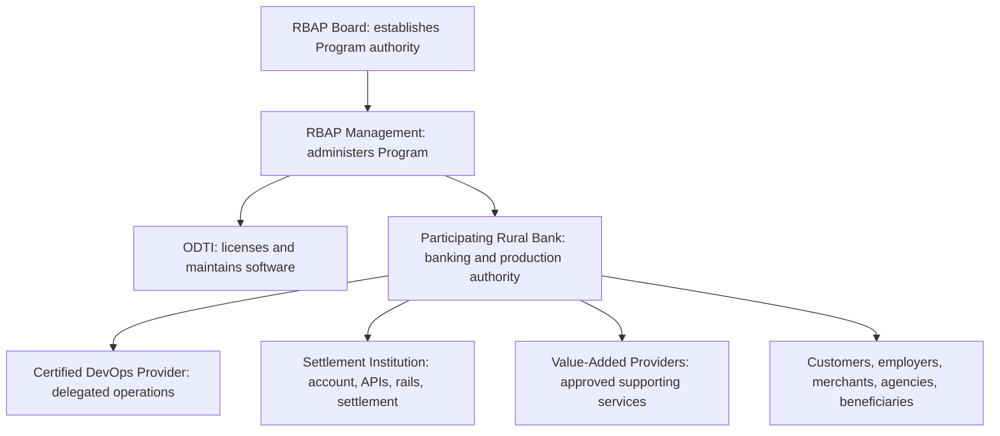

*Caption: Program coordination, software authority, banking authority, delegated operations, and settlement responsibility remain distinct.*

#### Independent Bank Deployments Under One Program

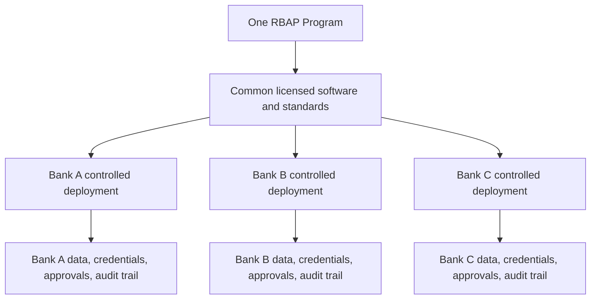

*Caption: Collective modernization shares software and standards, not production tenancy, institutional data, or authority.*

#### Direct Settlement Relationships

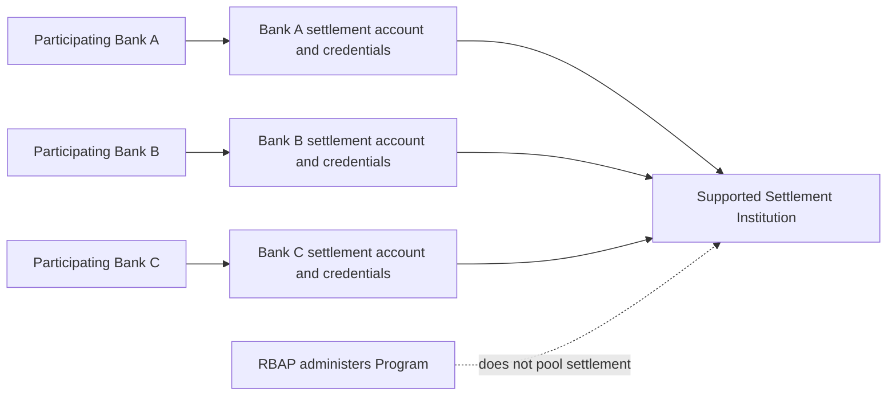

*Caption: A common Settlement Institution may support multiple banks while each bank retains its own direct account, credentials, authority, and reconciliation.*

#### Banking Operating Model

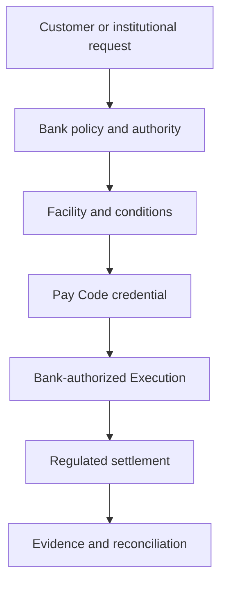

*Caption: The operating model connects a banking request to a governed outcome without displacing the bank or Settlement Institution.*

#### Funding Event

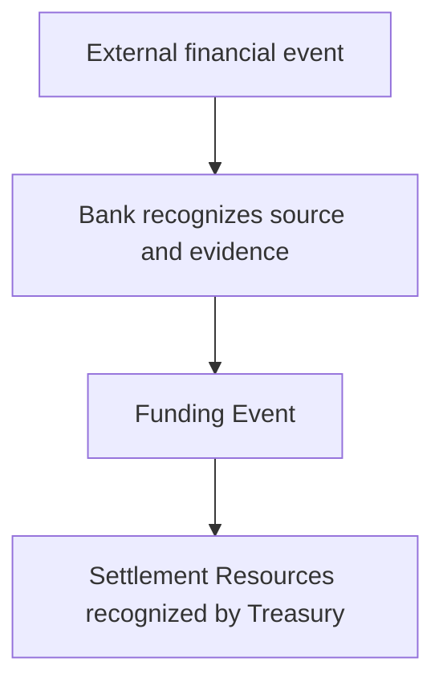

*Caption: A Funding Event records recognized financial value; it does not create that value.*

#### Treasury

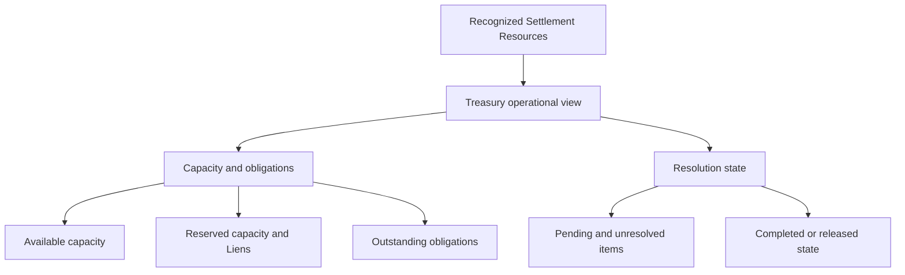

*Caption: Treasury distinguishes operational state while underlying funds remain in the bank's regulated relationships.*

#### Funding Event to Execution Lifecycle

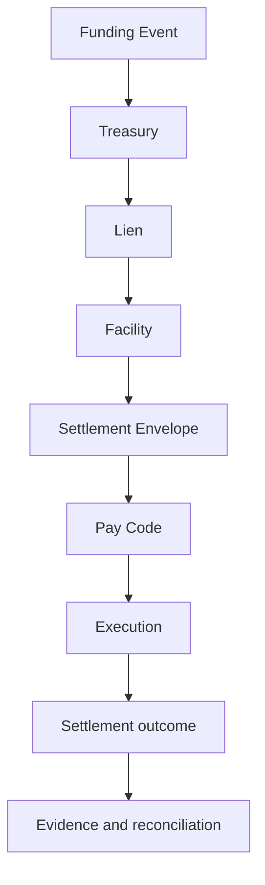

*Caption: The canonical grammar moves from recognition to governed execution and resolution.*

#### Deposit Flow

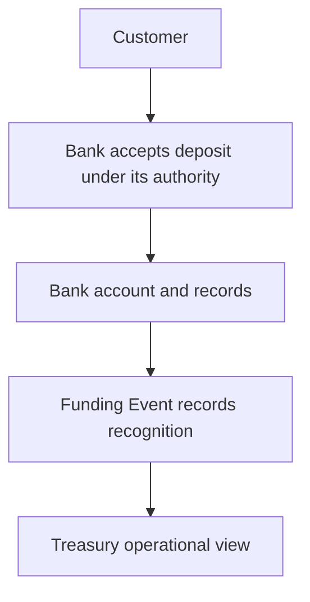

*Caption: The deposit belongs to the bank-customer relationship; Treasury records only the approved operational recognition.*

#### Payroll Flow

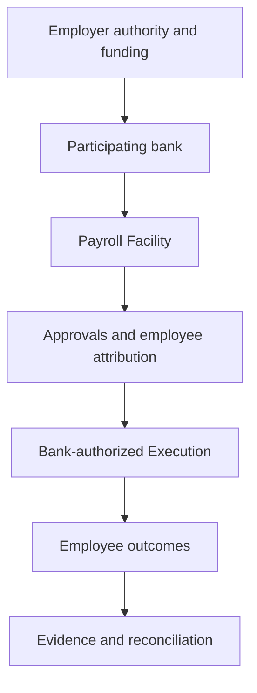

*Caption: Payroll remains a bank-governed service from employer authority through employee outcomes.*

#### Merchant Flow

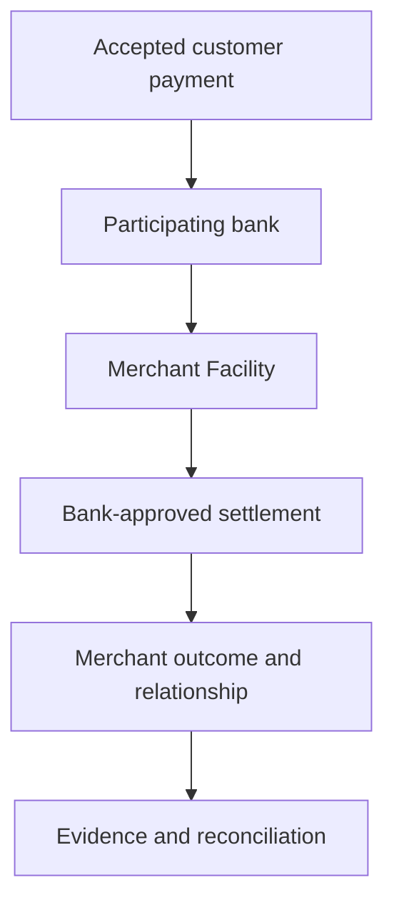

*Caption: Merchant activity is governed through the bank's Facility and direct settlement arrangements.*

#### Government Disbursement Flow

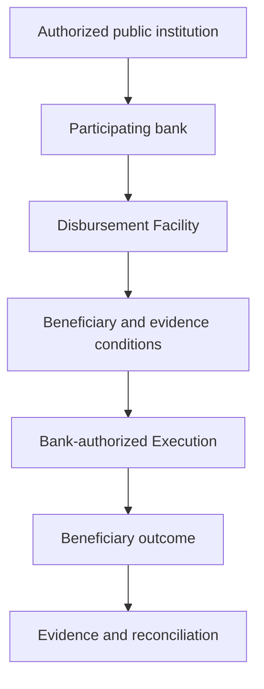

*Caption: Government disbursement remains subject to agency authority, bank governance, beneficiary conditions, and reconciliation.*

#### Commercial Waterfall

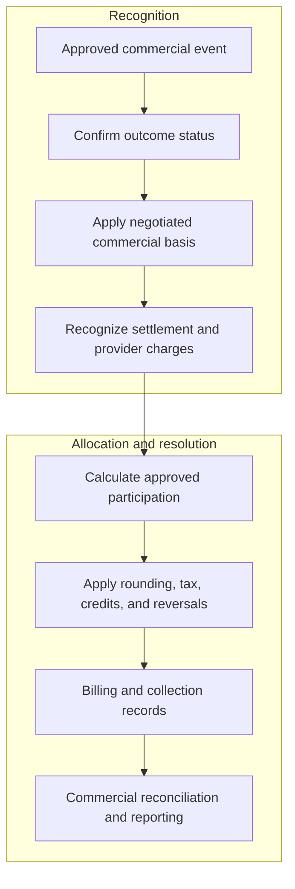

*Caption: The Commercial Waterfall is an accountability sequence separate from customer-fund custody and regulated settlement.*

#### Deployment Architecture

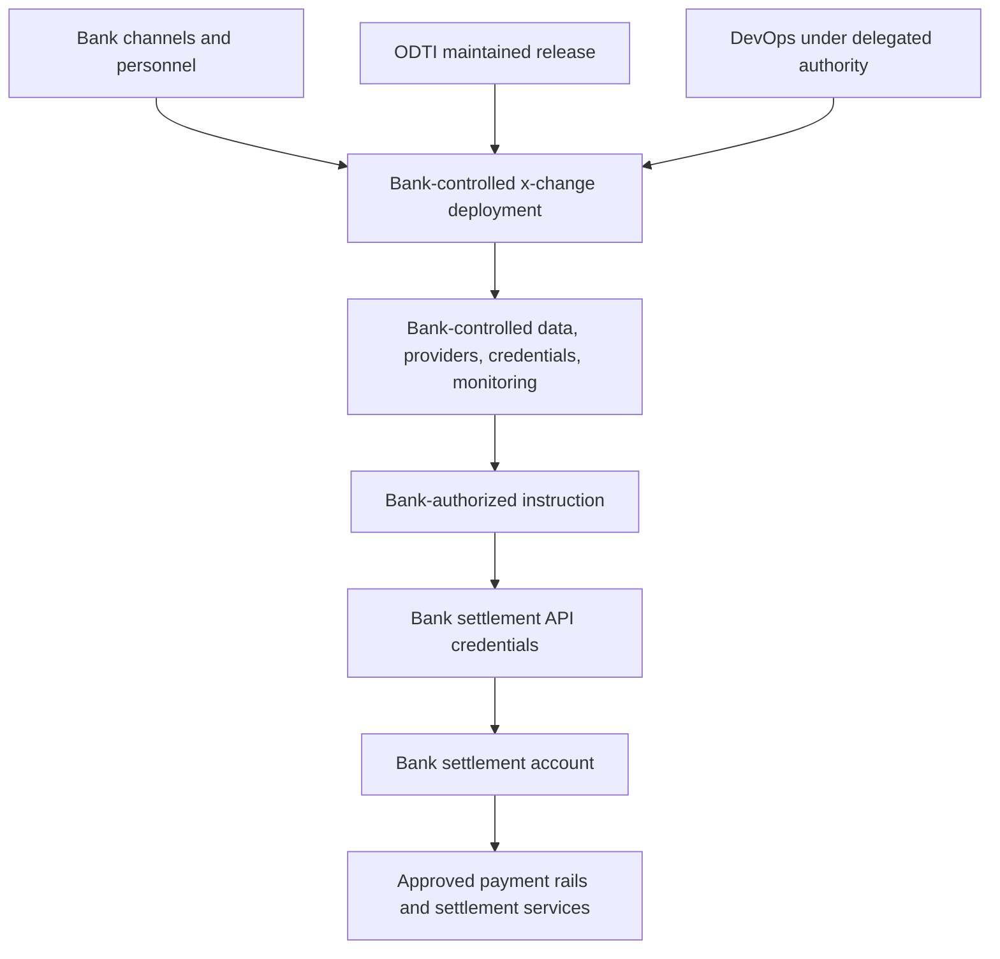

*Caption: Maintained software and delegated operations extend a bank-controlled deployment and direct settlement relationship.*

### Editorial Illustration Sources

#### Familiar Remittance Pattern

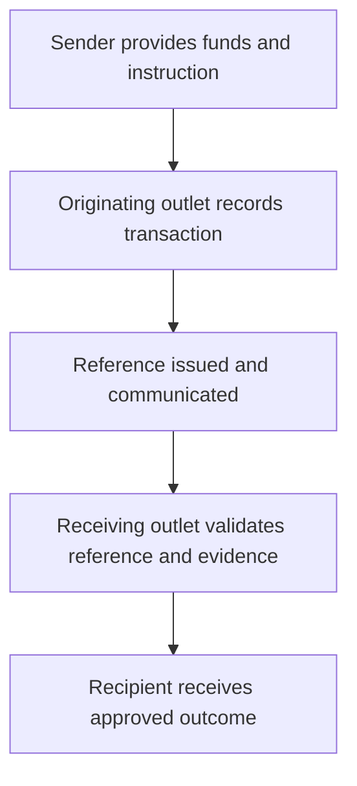

*Caption: The familiar remittance reference carries an instruction while the institution retains responsibility until release.*

#### Operating Perspectives

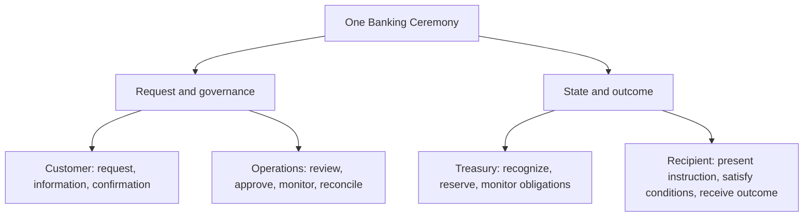

*Caption: Different participants experience one banking activity governed by one institution.*

#### Source-to-Settlement Operating Flow

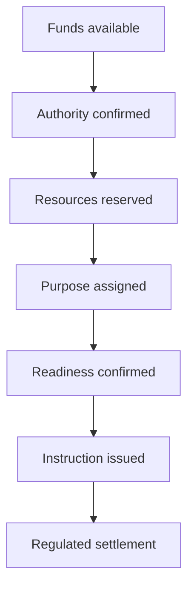

*Caption: Supporting funds, authority, purpose, readiness, instruction, and settlement remain distinct.*

#### End-to-End Banking Activity

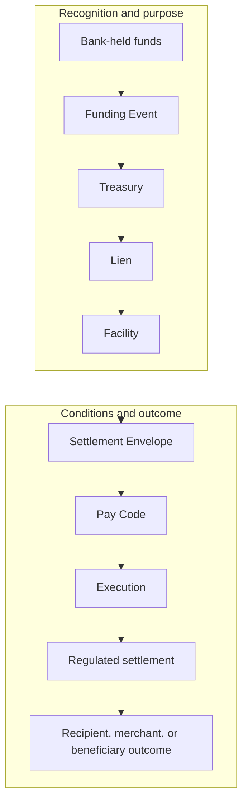

*Caption: The end-to-end grammar coordinates an authorized outcome while funds remain within the regulated banking relationship.*

#### Manager's Check and Pay Code Customer Journey

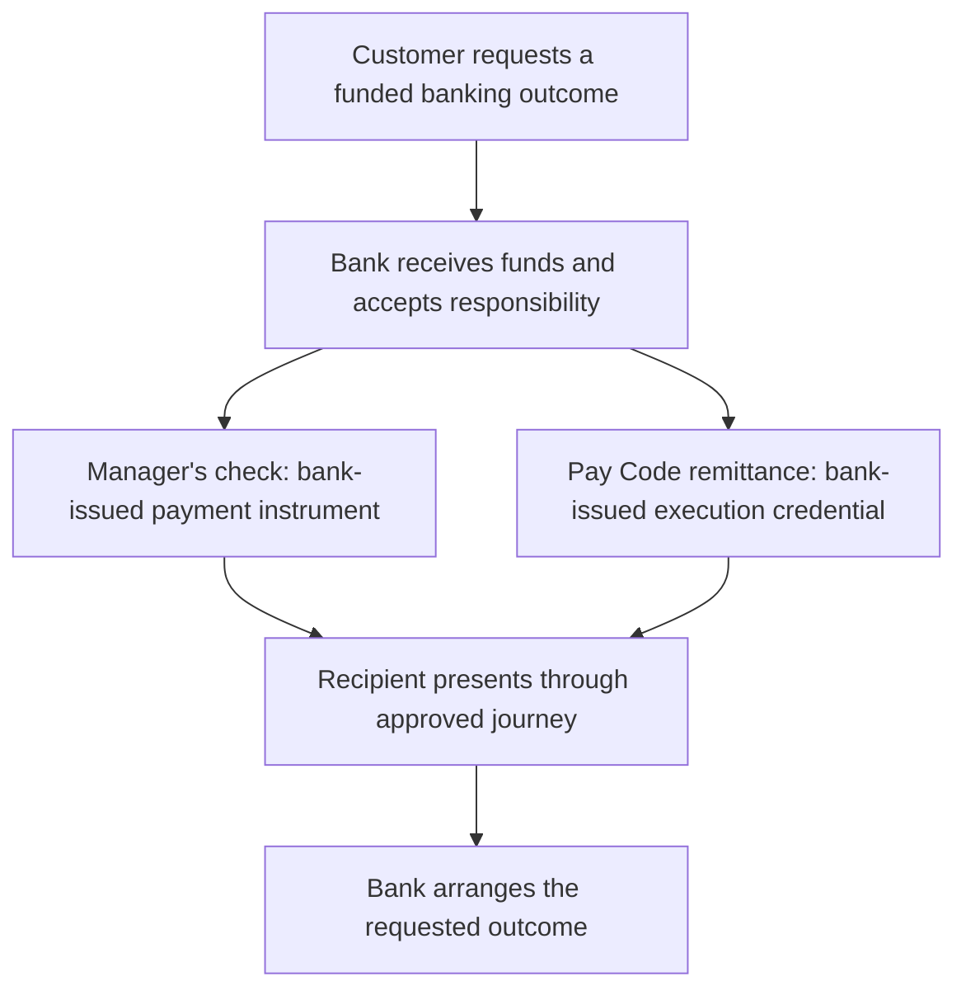

*Caption: The instruments differ, but the customer experiences a bank accepting responsibility for a funded outcome.*

#### Behind the Counter

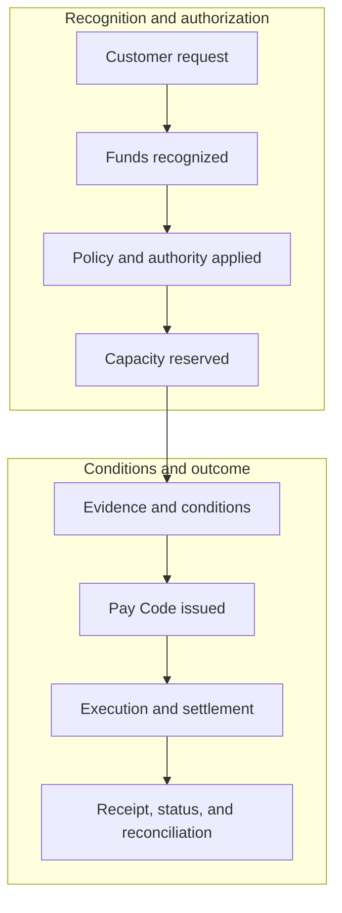

*Caption: The customer sees a simple service while the bank performs a complete governed ceremony.*

#### One Ceremony, Many Banking Services

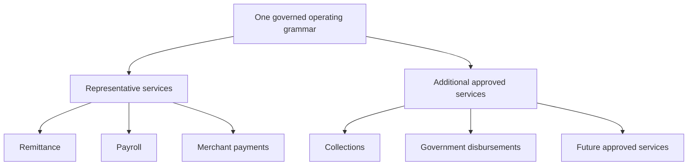

*Caption: New services vary purpose, participants, policies, conditions, and experience without rebuilding the operating foundation.*

### Institutional and Launch Diagrams

#### Transaction Gravity

```mermaid
flowchart TB
    First["One useful banking service"] --> Return["Recurring usefulness"] --> Relationships["Deeper customer, employer, and merchant relationships"] --> Activity["More financial needs served"] --> First
```

*Caption: Transaction Gravity develops through recurring institutional usefulness, not volume alone.*

#### Institutional Adaptability

```mermaid
flowchart TB
    Foundation["Governed operating foundation"] --> Ceremony["Define a new Banking Ceremony"] --> Approve["Apply bank policy and authority"] --> Ready["Confirm readiness"] --> Service["Introduce approved service"] --> Learn["Evidence and learning"] --> Ceremony
```

*Caption: Adaptability allows the bank to assume new responsibilities without reconstructing its foundation.*

#### Collective Modernization

```mermaid
flowchart TB
    Shared["Shared software, standards, engineering, and learning"] --> BankA["Independent Bank A"]
    Shared --> BankB["Independent Bank B"]
    Shared --> BankC["Independent Bank C"]
    BankA --> CompeteA["Own customers, policies, services, governance"]
    BankB --> CompeteB["Own customers, policies, services, governance"]
    BankC --> CompeteC["Own customers, policies, services, governance"]
```

*Caption: Participating banks modernize collectively while competing and operating independently.*

#### Launch Gates

```mermaid
flowchart TB
    subgraph Establish["Establish"]
        direction LR
        Program["Establish Program"] --> Institution["Understand institution"] --> Ceremony["Define first ceremony"] --> Foundations["Establish operating and settlement foundations"]
    end
    subgraph Operate["Validate and operate"]
        direction LR
        Ready["Confirm operational readiness"] --> Prepare["Prepare institution"] --> Pilot["Controlled Pilot"] --> Review["Evidence review"]
    end
    Foundations --> Ready
```

*Caption: Board approval begins a governed institutional sequence; it does not place a bank into production.*

#### Pilot Governance

```mermaid
flowchart TB
    Evidence["Pilot evidence"] --> Proceed["Proceed"]
    Evidence --> Correct["Correct"]
    Evidence --> Extend["Extend"]
    Evidence --> Pause["Pause"]
```

*Caption: Pilot evidence supports an institutional decision to Proceed, Correct, Extend, or Pause; expansion is not automatic.*
