# Appendix G — Canonical Diagrams

These Mermaid diagrams express the governed concepts in the Guide. They describe responsibility and sequence, not production topology or legal fund characterization.

## Program Participants

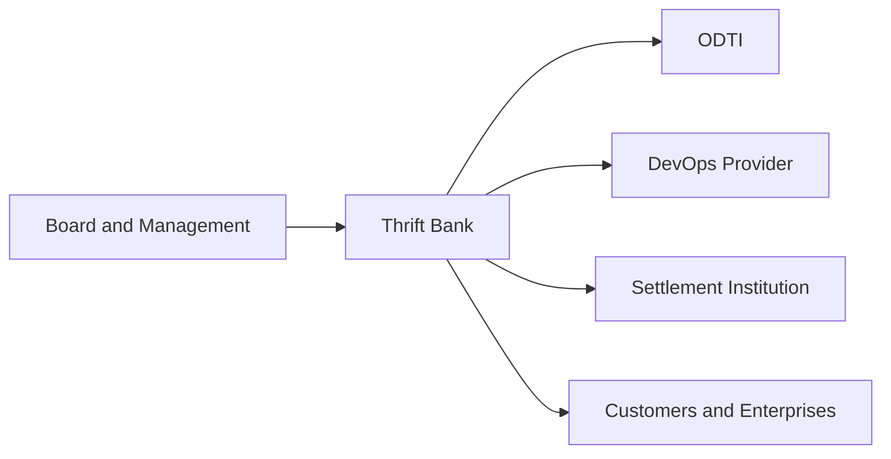

## Institutional Boundaries

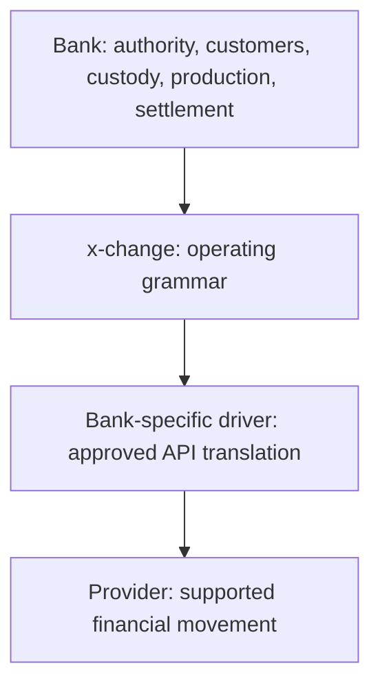

## Banking Operating Model

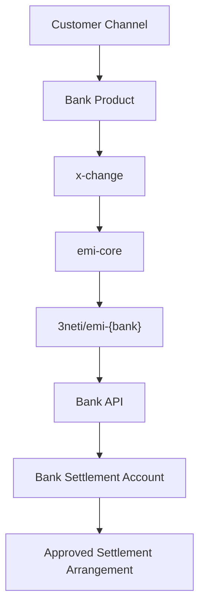

## Operating Grammar

## Funding Event and Treasury

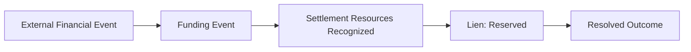

## Deposit Flow

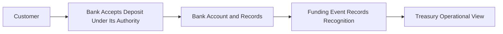

## Driver Architecture

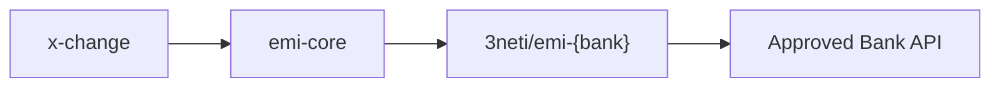

## Program Lifecycle

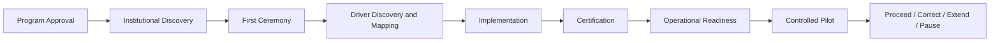

## Readiness

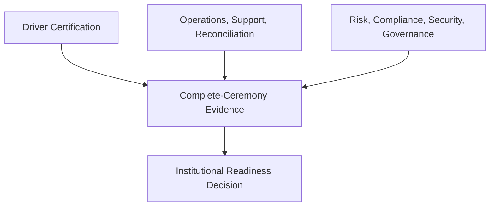

## Remittance Flow

## Payroll Flow

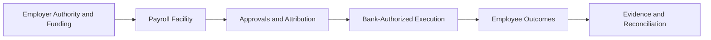

## Merchant Flow

## Government Disbursement Flow

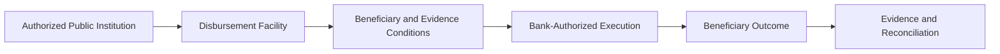

## Commercial Waterfall

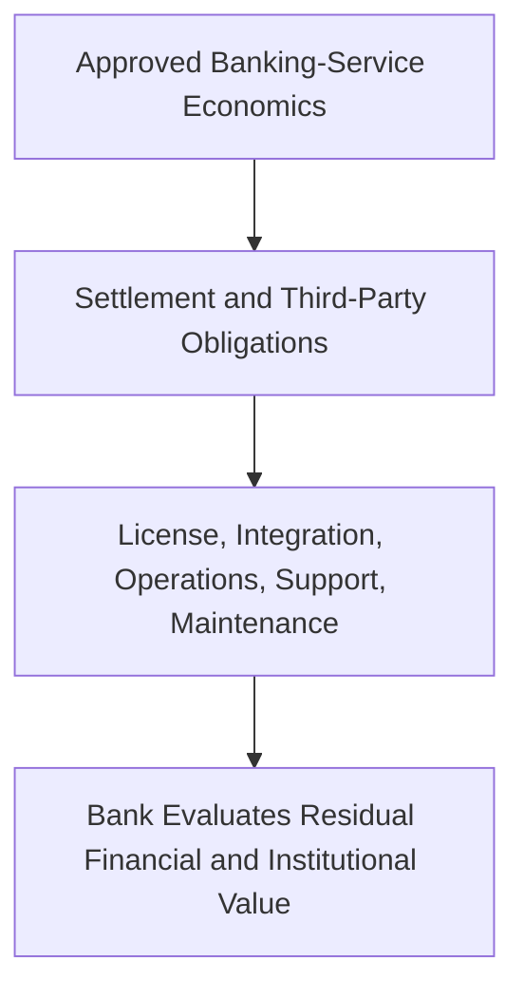

## Transaction Gravity and Service Expansion

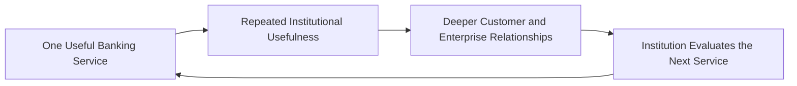

## Deployment Architecture

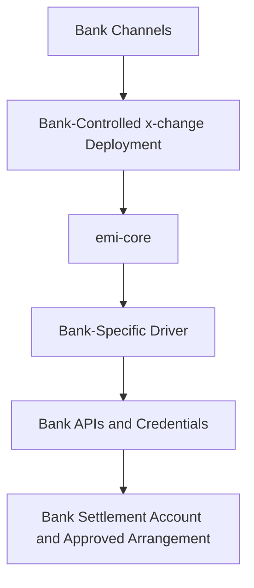

