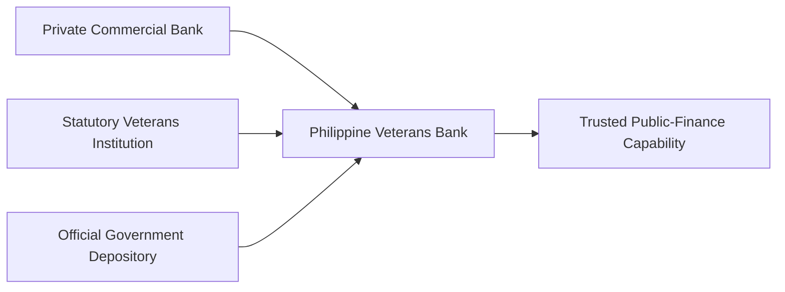

# Annex H — Applying This Program Guide to PVB

This paper was prepared for an institution that already possesses commercial-bank authority, a statutory veterans purpose, official government-depository status, established public and constituent relationships, digital channels, payment participation, Treasury capability, and broad banking activities. That profile informed the institutional examples without presuming adoption or production readiness.

The proposed ceremony sequence is intentionally controlled. Bounded public assistance is the primary discovery candidate. Public collections follow as the secondary candidate. Veterans' benefits and government or military payroll remain strategic later candidates. Treasury and GOCC services remain for later evaluation. Procurement settlement remains deferred pending direct institutional evidence.

The Guide identifies where one governed operating capability may align with those responsibilities. It preserves the boundaries between public authority and PVB's banking service, custody and operational Treasury state, approved execution and supporting integration, and technical validation and institutional readiness. It does not assert PVB's current operating methods, recommend a production design, establish commercial terms, guarantee deposits or government selection, or conclude that the institution is ready to proceed.

## Economic Evaluation

The Commercial Waterfall evaluates an approved public-finance service by considering authorized fees, deposits, activity, and public value against public-program and provider obligations; PVB operating, governance, and control costs; and licensing, integration, infrastructure, support, and maintenance. The residual must support dependable operation while preserving clear accountability for who authorizes, performs, earns, pays, bears risk, and remains answerable for the outcome. Detailed economics require PVB information and separate commercial analysis.

## Immediate Invitation

The immediate invitation authorizes nothing beyond institutional dialogue and, if PVB chooses, formal evaluation. It does not authorize procurement, implementation, a public program, system access, settlement activity, or production. If bounded public assistance is not suitable, PVB would return to the proposed candidate sequence rather than force selection.

The result is a basis for executive dialogue: whether this capability belongs within PVB's future, whether bounded public assistance should test that judgment first, and what evidence PVB would require before considering any further decision.
