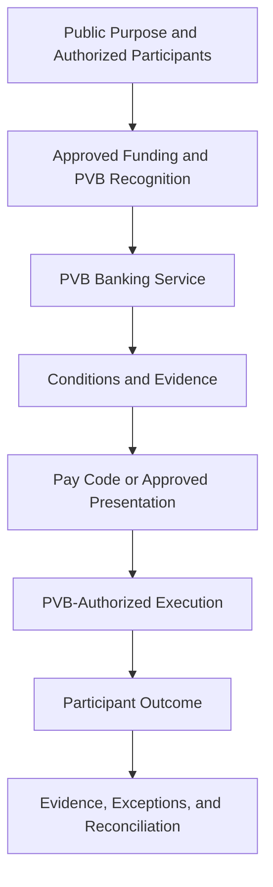
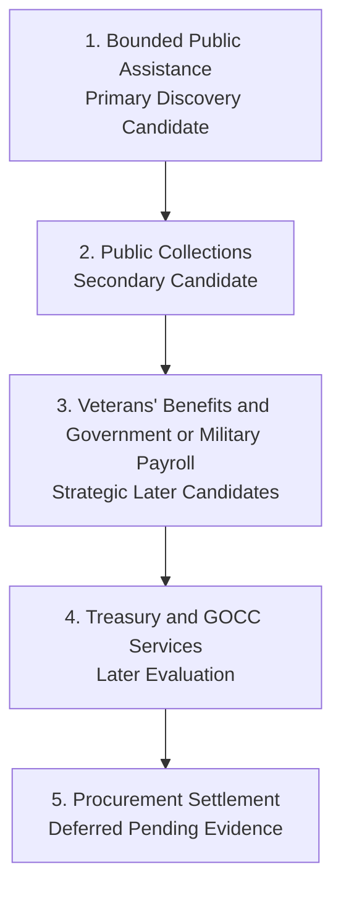

# Annex B — Banking Ceremonies

A governed public-finance ceremony is the complete progression through which authorized public purpose becomes executable, evidenced, and reconciled banking activity. The ceremonies below illustrate how one operating grammar can support different institutional purposes. They do not establish implementation approval or production scope.

### Bounded Public-Assistance Disbursement

The responsible public institution identifies the approved participants, funding authority, public purpose, evidence, and conditions. PVB confirms its banking authority, applies policy, recognizes the supporting resources, and accepts responsibility for the banking outcome.

Treasury recognizes the Settlement Resources and reserves the required capacity. The assistance Facility defines participants, limits, service rules, communication, and institutional responsibility. Settlement Envelopes establish evidence and conditions. A Pay Code or other approved presentation communicates the authorized instruction. Execution proceeds through PVB's approved capability, while the resulting institutional and provider evidence supports participant communication, exception handling, and reconciliation.

Bounded public assistance is the primary discovery candidate because it can make the complete discipline visible within a limited public responsibility. Its suitability, authority, economics, and readiness would still need to be confirmed with PVB and the responsible public institution.

### Public Collections

A payer submits funds for a defined public obligation. PVB captures the payer, public institution, purpose, reference, amount, channel, and applicable conditions. The collections Facility defines matching and exception rules. The Settlement Envelope preserves required evidence. Execution coordinates the approved financial outcome. The completed record supports attribution, posting, exception resolution, public reporting, and reconciliation.

The ceremony connects financial movement with institutional meaning. A successful transfer without reliable attribution may still leave the collection unresolved. Public collections follow as the secondary discovery candidate.

### Veterans' Benefits

An authorized veterans' benefit connects a responsible public institution, an eligible participant, approved funding, continuing conditions, and PVB's statutory constituency. The Facility defines the banking service and participant treatment. Settlement Envelopes carry entitlement, identity, approval, and other required evidence. Treasury recognizes and reserves the supporting resources. Execution proceeds through PVB's approved capability, and the operating record preserves recurring status, exceptions, evidence, and reconciliation.

The ceremony does not create benefit authority or eligibility. Veterans' benefits remain a strategic later candidate whose current program basis and operating journey require direct institutional confirmation.

### Government or Military Payroll

A government or military employer submits an authorized payroll instruction and provides or identifies the supporting funds. PVB validates authority, timing, personnel attribution, limits, exceptions, and required evidence. Treasury recognizes and reserves the Settlement Resources. The payroll Facility defines the banking service. Settlement Envelopes establish the conditions for release. Execution proceeds through PVB's approved capability, and the resulting evidence supports reporting, exception handling, and reconciliation.

Payroll may connect public employers, personnel, deposits, payments, and continuing banking relationships. It remains a strategic later candidate rather than an assumed first service.

### Treasury and GOCC Services

An approved Treasury or GOCC obligation may require recognized resources, authorized release, institutional references, conditions, execution, and evidence. The Facility defines PVB's banking responsibility. Treasury maintains the operational financial state. Settlement Envelopes carry approvals and conditions. Execution proceeds through the approved arrangement, with resulting records returned for accounting, exception handling, and reconciliation.

These services remain for later evaluation. Their value and feasibility depend on the applicable authority, accounts, institutional role, controls, providers, and service design.

### Procurement Settlement

An approved procurement obligation may connect contract authority, acceptance evidence, a supplier or other authorized payee, payment conditions, execution, records, and reconciliation. The ceremony would not replace procurement authority, acceptance, legal review, accounting, or audit.

Procurement settlement remains deferred pending direct institutional evidence. Deferral preserves the ceremony without presenting it as a current PVB priority.

Across these ceremonies, purpose and policy change. The responsibilities remain recognizable: funds, authority, conditions, credential where required, execution, evidence, exception handling, and reconciliation.

