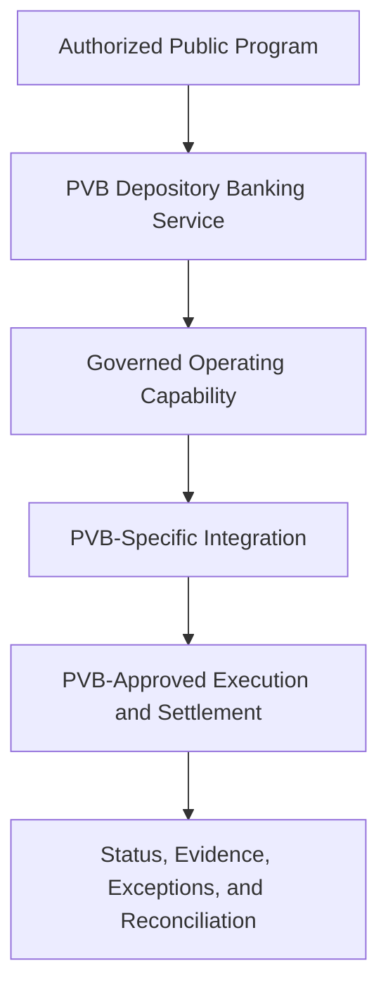
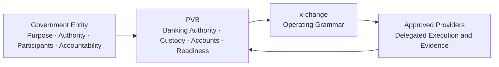

# Annex A — Canonical Operating Model

The operating model separates public authority, the PVB banking service, the governed public-finance ceremony, institution-specific integration, and regulated financial movement.

```text
Responsible Government Entity
          ↓
PVB Products and Channels
          ↓
PVB Depository Banking Service
          ↓
x-change
          ↓
PVB-Specific Integration
          ↓
PVB-Approved Execution Capability
          ↓
PVB-Governed Settlement or Payment Arrangement
          ↓
Applicable Approved Rail, Provider, or Internal Capability
```

This model is conceptual. It describes institutional responsibilities and integration boundaries, not a production topology.



**The responsible government entity** defines or administers public purpose, lawful authority, participant basis, funding authority, approvals, conditions, reporting, and public accountability.

**PVB products and channels** initiate, present, or report banking activity. They may include branches, retail and institutional digital banking, cards, kiosks, gateways, partner journeys, and approved interfaces.

**The PVB banking service** defines the banking outcome, participants, terms, policy, commercial meaning, service responsibility, and participant treatment. The banking service remains the product.

**x-change** coordinates the governed ceremony: recognized resources, purpose, authority, conditions, credential, execution, evidence, exceptions, and reconciliation.

**PVB-specific integration** connects the operating grammar to the institution's approved authentication, instruction, reference, status, exception, reversal, security, provider, evidence, and reconciliation behavior. Its engineering boundary is described in Annex C.

**PVB-approved execution interfaces and governed settlement or payment arrangements** remain under PVB and provider authority. Financial movement occurs through the bank's regulated relationships. The software neither creates settlement access nor assumes custody.

The model preserves four boundaries:

1. The government entity retains public authority and accountability.
2. PVB defines and owns the banking service.
3. The operating grammar coordinates the service without replacing institutional authority.
4. Execution reaches approved financial infrastructure only through PVB-governed integration.

Common software does not create a common bank. PVB retains its own policies, environment, data, credentials, government and customer relationships, settlement relationships, production decisions, and audit trail.


