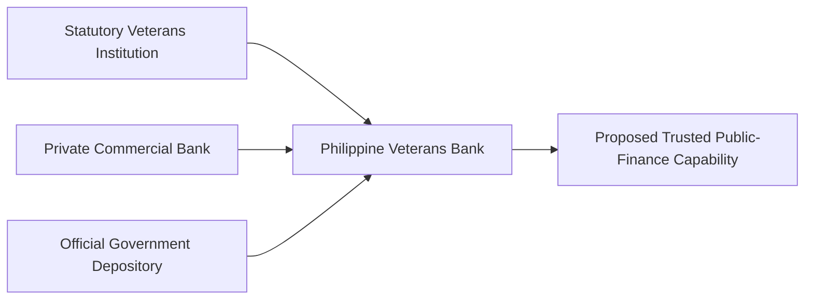
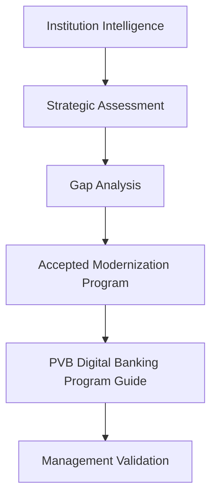
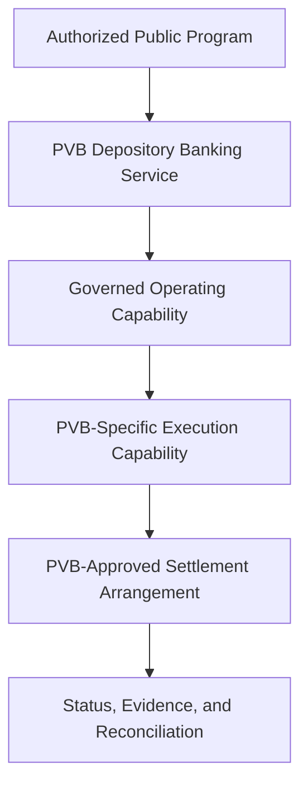
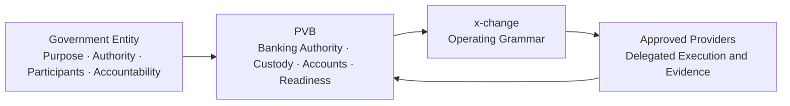
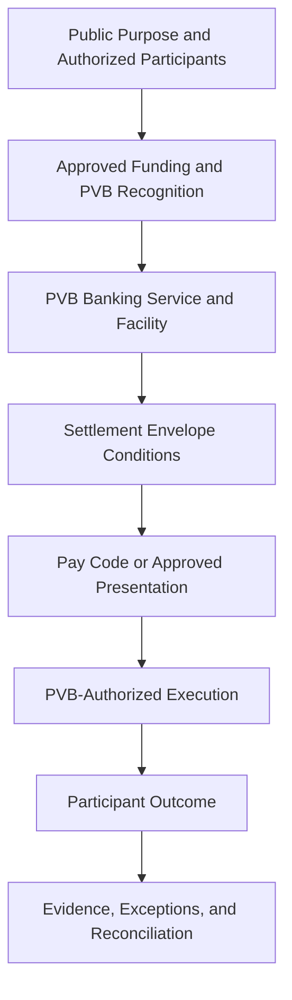
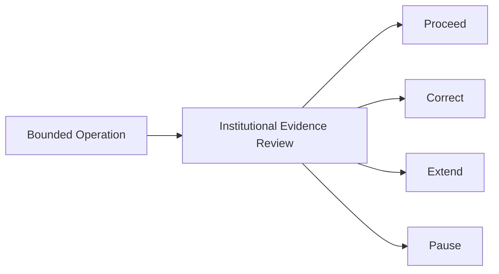

# Appendix G — Program Diagrams

These diagrams specialize the approved Government Depository operating concepts for PVB without changing canonical definitions. They are editorial source diagrams, not implementation specifications.

## Institutional Identity

## Program Lineage

## Operating Model

## Responsibility Boundaries

## Bounded Public-Assistance Ceremony

## Readiness Progression

No arrow makes the next state automatic. Each transition requires the evidence and authority appropriate to the responsibility being considered.

## Evidence Review

