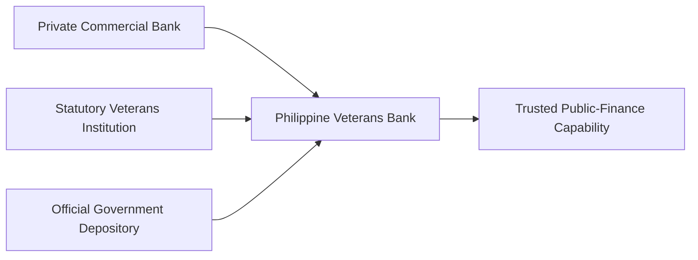
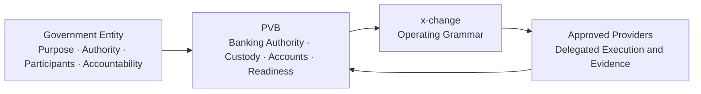
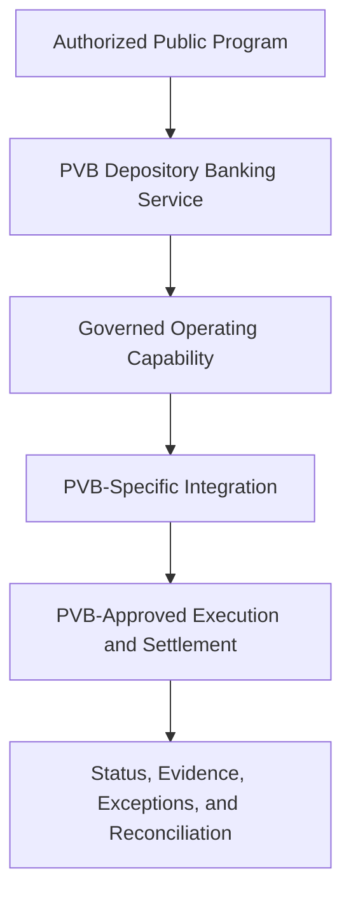
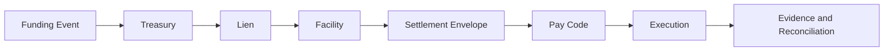
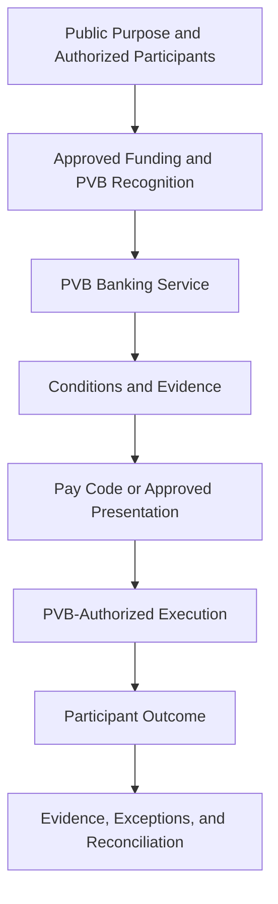
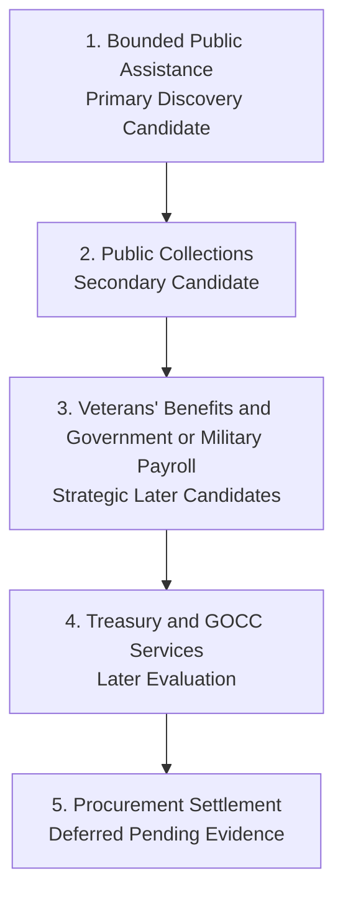
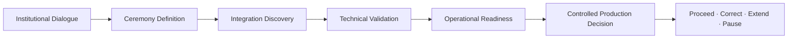

# Appendix G — Program Diagrams

These diagrams provide conceptual views of the PVB Program. They preserve the canonical operating distinctions and do not prescribe implementation.

## Institutional Identity

## Program Participants

## Banking Operating Model

## Operating Grammar

## Bounded Public-Assistance Ceremony

## Candidate Ceremony Sequence

## Readiness Progression

No arrow makes the next state automatic. Each transition requires the authority and evidence appropriate to the responsibility being considered.
