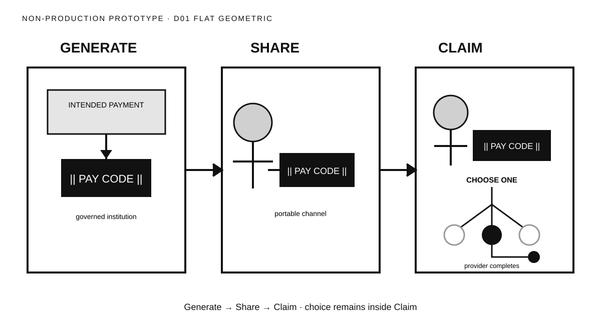

# Direction 01 — Flat Geometric



## Visual thesis

Reduce every actor and state to firm geometric primitives. Clear containment and contrast should make the journey legible without relying on illustrative personality.

## Composition sketch

```text
[ intended payment → Pay Code ] → [ credential moves ] → [ recipient + choice → one completion ]
          GENERATE                        SHARE                         CLAIM
```

## Intended reading order

Three equal frames read left to right. The intended payment appears before the dark Pay Code tile. The tile persists through Share. Claim contains the only branch, and one filled destination continues to completion.

## Semantic strengths

- Strong separation of the three moments.
- Pay Code continuity is immediate.
- Filled versus unfilled destination primitives make singular selection clear.
- Geometry scales cleanly from small card to large display.
- Institutional containment is visible without becoming architectural detail.

## Semantic risks

- Equal frames can make Claim feel no more important than Generate or Share.
- Abstract people may reduce human warmth.
- Dark Pay Code blocks may become the visual hero.
- The institutional frame could be mistaken for a software interface if over-refined.

## Likely experience surfaces

Event, social, presentation, print, and documentation.

## Skeptical reviewer notes

- **First eye position:** Dark Pay Code tile, then the three frames.
- **What appears to move:** The credential.
- **What the Pay Code appears to contain:** No visible money; it reads as a label or credential.
- **Recipient action:** Visible, though mechanically expressed.
- **Claim payoff:** Clear but not emotionally dominant.
- **Choice nesting:** Clear inside the Claim frame.
- **Selected destination:** Exactly one filled destination.
- **Institutional layer:** Secondary.
- **Memory prospect:** Strong three-panel recall.
- **What can be removed:** The extra institution outline beneath Generate if first-reader testing finds the boundary already clear.

## Validation notes

Expected strengths are the Caption and scalability checks. The primary open question is whether a first-time reader recalls human action or only three geometric boxes. No reader-test result is claimed.

## Prototype status

Non-production visual study. No canonical style selected.
