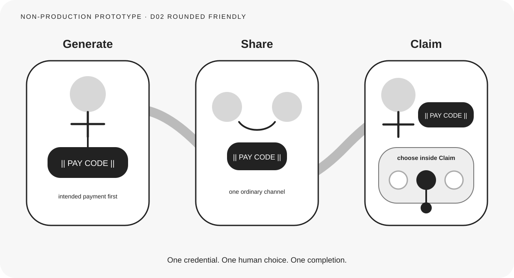

# Direction 02 — Rounded Friendly



## Visual thesis

Use soft enclosures, rounded paths, and approachable human figures to make the recipient's agency feel natural and the completion feel calm.

## Composition sketch

```text
( intended payment ) ~~~ ( share between people ) ~~~ ( Claim contains choice )
```

## Intended reading order

A broad curved path connects three rounded scenes. The Pay Code emerges under the sender, moves between people, and stops beside the recipient. A soft nested field opens beneath the recipient for bounded choice.

## Semantic strengths

- Human actors receive more attention than infrastructure.
- Claim feels welcoming and visibly recipient-led.
- Rounded nested field makes Choice feel part of Claim.
- Calm completion supports consumer and public-purpose contexts.
- Curved continuity may translate naturally into motion.

## Semantic risks

- Friendly styling may feel less credible for formal institutional audiences.
- The curved background path could be mistaken for money flow.
- Similar visual weight across scenes may weaken the intended-payment origin.
- Softness may reduce distance legibility.

## Likely experience surfaces

Web, motion, social, presentation, and public-facing print.

## Skeptical reviewer notes

- **First eye position:** Human figures and rounded Claim field.
- **What appears to move:** The Pay Code, though the broad curve needs testing.
- **What the Pay Code appears to contain:** No balance or money cues.
- **Recipient action:** Strong.
- **Claim payoff:** Strongest emotional payoff among the softer directions.
- **Choice nesting:** Very clear.
- **Selected destination:** One dark destination and one completion.
- **Institutional layer:** Quiet; perhaps too quiet in Generate.
- **Memory prospect:** Moderate to strong, especially in motion.
- **What can be removed:** The broad decorative path if viewers interpret it as funds.

## Validation notes

Doctrine testing should concentrate on the meaning of the curved path. Institutional reviewers should assess whether warmth undermines seriousness. No reader-test result is claimed.

## Prototype status

Non-production visual study. No canonical style selected.
