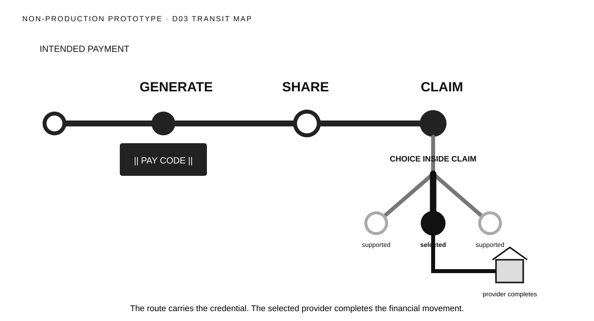

# Direction 03 — Transit Map



## Visual thesis

Treat VIS-001 as one memorable route with three stations. A branch appears only at Claim, and one route visibly continues to one participating provider.

## Composition sketch

```text
intention ──● Generate ──○ Share ──● Claim
                                      ├ destination
                                      ● selected ── completion
                                      └ destination
```

## Intended reading order

The eye follows one heavy route from intention through Generate, Share, and Claim. The route branches only after Claim. One dark selected branch continues to completion; alternatives remain quiet.

## Semantic strengths

- Exceptional order and continuity.
- Strong candidate for the Memory Test.
- Recipient Choice is spatially subordinate to Claim.
- Selected route and singular completion are unmistakable.
- Works across static, progressive, and motion surfaces.

## Semantic risks

- Transit metaphors may imply rails, network coverage, or guaranteed routes.
- Human actors are weak or absent.
- The line may be mistaken for money movement rather than credential journey.
- Station logic may make Share appear to complete a transfer automatically.

## Likely experience surfaces

Event, presentation, motion, web, social, and conference displays.

## Skeptical reviewer notes

- **First eye position:** The dominant route.
- **What appears to move:** Ambiguous without testing; intended to be the credential.
- **What the Pay Code appears to contain:** No money, though the route metaphor requires a boundary cue.
- **Recipient action:** Weakest aspect.
- **Claim payoff:** Structurally strong, humanly restrained.
- **Choice nesting:** Excellent.
- **Selected destination:** Excellent.
- **Institutional layer:** Secondary and legible at the end.
- **Memory prospect:** Very strong.
- **What can be removed:** Secondary destination labels; the route geometry already conveys bounded choice.

## Validation notes

This direction should not advance without confirming that viewers describe the route as the credential journey rather than a settlement rail. No reader-test result is claimed.

## Prototype status

Non-production visual study. No canonical style selected.
