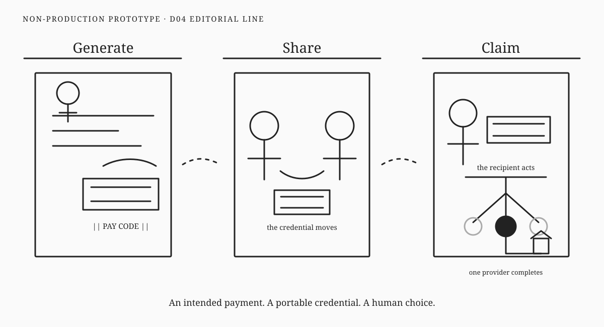

# Direction 04 — Editorial Line



## Visual thesis

Use sparse human scenes and restrained linework to explain intention, exchange, and recipient choice like an editorial essay rather than a product diagram.

## Composition sketch

```text
institutional scene      person-to-person scene      recipient-at-provider scene
     Generate          →          Share           →            Claim
```

## Intended reading order

Three narrative frames read as successive observations. The intended payment appears within the institutional scene. The central scene shows two people and one credential. The final scene gives the recipient the active role and contains the choice detail.

## Semantic strengths

- Strong human and institutional balance.
- Suitable for serious long-form and executive publications.
- Avoids product-interface conventions.
- Recipient action is narratively clear.
- Institutional completion can remain subtle without disappearing.

## Semantic risks

- Fine lines may fail at distance or small size.
- Narrative detail may weaken the Fifteen-Second Test.
- Similar scenes can feel like a comic strip rather than a single memorable composition.
- Pay Code continuity depends on close inspection.

## Likely experience surfaces

Print, documentation, executive presentation, and web editorial modules.

## Skeptical reviewer notes

- **First eye position:** Human figures, then scene boundaries.
- **What appears to move:** The credential, but less forcefully than in geometric directions.
- **What the Pay Code appears to contain:** Nothing; it behaves like a document.
- **Recipient action:** Strong.
- **Claim payoff:** Humanly credible.
- **Choice nesting:** Clear at normal reading distance.
- **Selected destination:** One filled choice.
- **Institutional layer:** Balanced and secondary.
- **Memory prospect:** Moderate; may retain story more than exact geometry.
- **What can be removed:** Interior document lines and one institutional cue to improve distance clarity.

## Validation notes

Testing should compare comprehension at arm's length and several metres. The direction may excel editorially while failing event use. No reader-test result is claimed.

## Prototype status

Non-production visual study. No canonical style selected.
