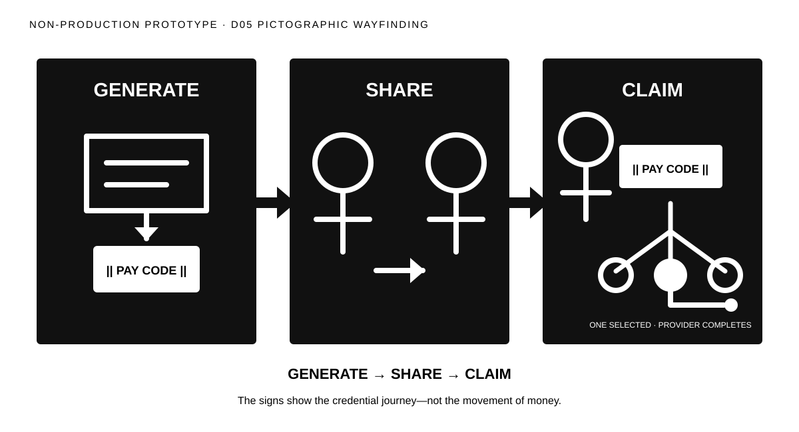

# Direction 05 — Pictographic Wayfinding



## Visual thesis

Use large, signage-like pictograms and decisive arrows so the journey reads at distance before supporting words are visible.

## Composition sketch

```text
| GENERATE pictogram | ⇒ | SHARE pictogram | ⇒ | CLAIM pictogram + nested choice |
```

## Intended reading order

Three dark signs create an immediate left-to-right sequence. White pictograms show the intended payment becoming a credential, people sharing it, and the recipient selecting one destination within Claim.

## Semantic strengths

- Strongest distance legibility.
- Clear three-step grouping.
- High grayscale contrast.
- Easily scalable for event and environmental surfaces.
- Simple icon relationships support later motion.

## Semantic risks

- Heavy black fields may dominate the human outcome.
- Signage can make the journey feel mandatory or infrastructural.
- Pictograms may become generic without distinctive composition behavior.
- Institutional nuance is easily lost at distance.

## Likely experience surfaces

Event, conference display, social, presentation, and motion.

## Skeptical reviewer notes

- **First eye position:** Three black signs and their labels.
- **What appears to move:** The credential through the middle sign.
- **What the Pay Code appears to contain:** Nothing; it reads as a pass or credential.
- **Recipient action:** Visible through presentation and selection.
- **Claim payoff:** Strong in scale, less nuanced emotionally.
- **Choice nesting:** Clear within the final sign.
- **Selected destination:** One filled choice.
- **Institutional layer:** Very quiet.
- **Memory prospect:** Strong.
- **What can be removed:** Footer explanation at large display scale.

## Validation notes

Test whether the Pay Code resembles a transit ticket or voucher balance. Doctrine review should confirm that the signage metaphor does not imply universal acceptance. No reader-test result is claimed.

## Prototype status

Non-production visual study. No canonical style selected.
