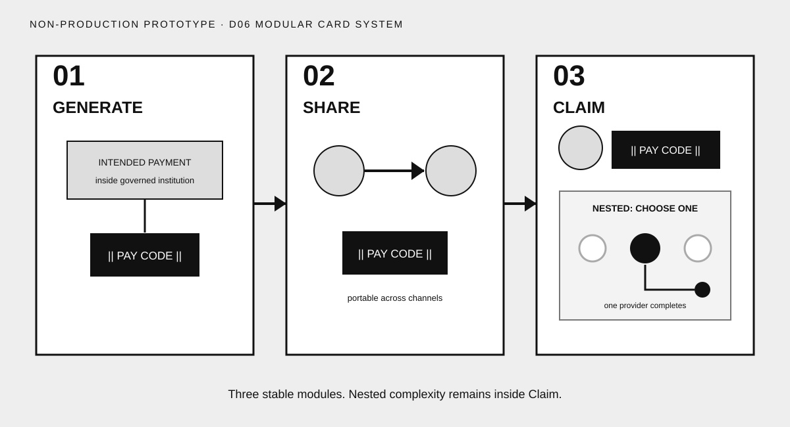

# Direction 06 — Modular Card System



## Visual thesis

Use three stable modules to protect the canonical sequence while allowing nested semantic cards inside each moment.

## Composition sketch

```text
[ 01 Generate ] → [ 02 Share ] → [ 03 Claim [Choice → one completion] ]
```

## Intended reading order

Numbered cards enforce order. Each card has one main action. Claim contains a visibly subordinate inner card for Recipient Choice and completion.

## Semantic strengths

- Excellent modularity across responsive and presentation surfaces.
- Nested Claim relationship is explicit.
- Each moment can be isolated without inventing a new composition.
- Strong support for progressive disclosure.
- Institutional detail can be added or removed within stable boundaries.

## Semantic risks

- Cards may resemble a software interface or workflow product.
- Numbering can over-formalize the human journey.
- Equal modules can suppress Claim's emotional payoff.
- Excess nested cards could encourage architecture-heavy explanations.

## Likely experience surfaces

Web, presentation, documentation, social carousel, and print.

## Skeptical reviewer notes

- **First eye position:** Step numbers and card titles.
- **What appears to move:** The Pay Code between cards.
- **What the Pay Code appears to contain:** No money cues.
- **Recipient action:** Clear in the final card.
- **Claim payoff:** Semantically strong, emotionally moderate.
- **Choice nesting:** Strongest explicit containment.
- **Selected destination:** Exactly one.
- **Institutional layer:** Controlled within Generate and completion.
- **Memory prospect:** Strong three-card recall.
- **What can be removed:** Step numbers if readers remember order without them.

## Validation notes

Caption testing should remove all labels to determine whether the cards still explain rather than merely organize. Reviewers should watch for UI interpretation. No reader-test result is claimed.

## Prototype status

Non-production visual study. No canonical style selected.
