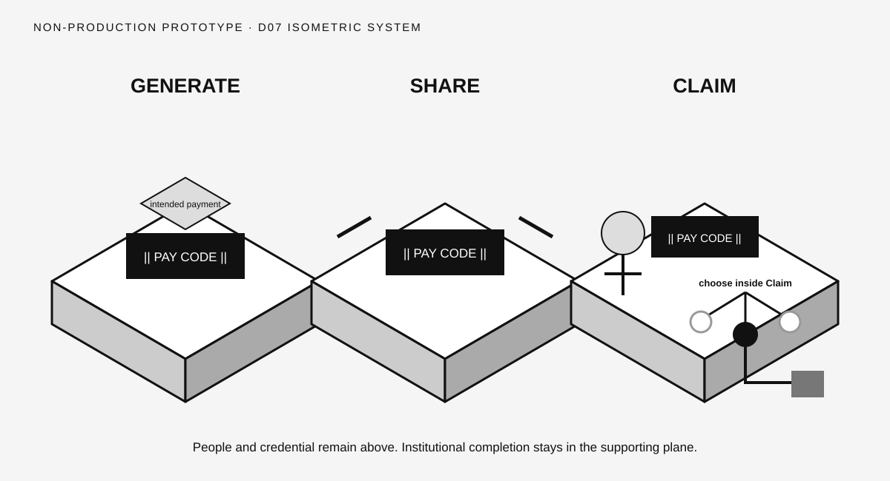

# Direction 07 — Isometric System



## Visual thesis

Use layered isometric platforms to separate the visible human journey from the supporting institutional plane beneath it.

## Composition sketch

```text
  Generate platform       Share bridge        Claim platform
  human + credential  →  credential moves  → recipient + nested choice
                                                     ↓
                                          provider completes below
```

## Intended reading order

Three platforms progress diagonally. The Pay Code remains on the upper human plane. Institutional completion appears beneath the selected destination at Claim.

## Semantic strengths

- Strong separation of human action and supporting infrastructure.
- Can reveal institutional depth without turning it into a public step.
- Distinctive among the eight directions.
- Suitable for progressive motion and presentation builds.
- Recipient Choice can occupy a clearly bounded platform area.

## Semantic risks

- Isometric depth adds complexity and drawing overhead.
- Platforms may resemble software architecture or a game board.
- The Pay Code may appear to move physically between systems.
- Small-format clarity is weak.
- Perspective can distract from the three verbs.

## Likely experience surfaces

Presentation, motion, web, and large-format event display.

## Skeptical reviewer notes

- **First eye position:** The three platforms.
- **What appears to move:** The Pay Code across the upper plane.
- **What the Pay Code appears to contain:** Nothing, although platform transfer needs doctrine testing.
- **Recipient action:** Visible.
- **Claim payoff:** Strong spatially.
- **Choice nesting:** Clear on Claim platform.
- **Selected destination:** One dark node.
- **Institutional layer:** Explicitly secondary below.
- **Memory prospect:** Moderate; perspective may replace verb memory.
- **What can be removed:** Platform side faces if they do not improve the infrastructure distinction.

## Validation notes

This direction needs the strongest Caption and Memory testing. Its distinctiveness is useful only if perspective does not add cognitive load. No reader-test result is claimed.

## Prototype status

Non-production visual study. No canonical style selected.
