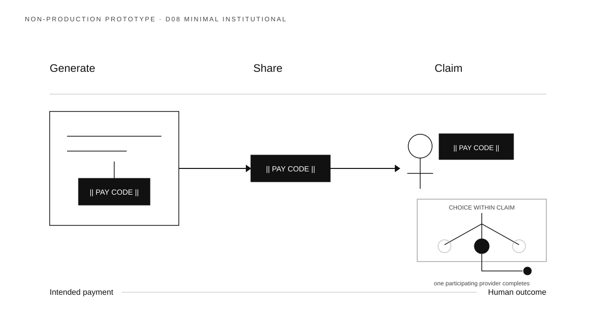

# Direction 08 — Minimal Institutional



## Visual thesis

Use extreme restraint, fine hierarchy, and quiet institutional boundaries to make VIS-001 feel credible in a Board-level context without sacrificing the human journey.

## Composition sketch

```text
Generate                     Share                    Claim
[instruction → code] ───── [same code] ───── [recipient + bounded choice → provider]
```

## Intended reading order

A thin continuous line carries the eye from an institutional Generate frame through an unframed Share interval to the recipient and a restrained nested Claim field.

## Semantic strengths

- Strong institutional credibility.
- Human outcome and institutional boundary coexist without decoration.
- Pay Code continuity remains clear.
- Excellent fit for executive print and presentation.
- Minimal styling reduces the risk of premature brand selection.

## Semantic risks

- Fine lines may disappear at event distance or small size.
- Restraint may feel cold or overly formal.
- Recipient agency is less immediate than in friendly or editorial directions.
- Quiet distinction between credential and financial completion may require close viewing.

## Likely experience surfaces

Executive print, presentation, documentation, and restrained web contexts.

## Skeptical reviewer notes

- **First eye position:** The three labels and dark credential tiles.
- **What appears to move:** The credential.
- **What the Pay Code appears to contain:** Nothing; it reads as a governed document.
- **Recipient action:** Present but understated.
- **Claim payoff:** Intellectually clear, emotionally quiet.
- **Choice nesting:** Clear through the containing field.
- **Selected destination:** Exactly one.
- **Institutional layer:** Appropriately secondary.
- **Memory prospect:** Strong structure, weaker human recall.
- **What can be removed:** The bottom intention-to-outcome line if it competes with the main journey.

## Validation notes

Test at actual event distance before considering this direction for banners. Institutional suitability is a hypothesis, not a measured result. No reader-test result is claimed.

## Prototype status

Non-production visual study. No canonical style selected.
